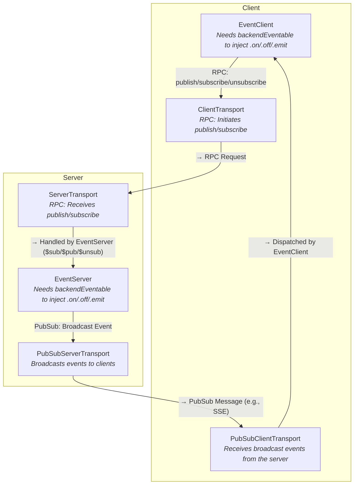

# @isdk/tool-event

> 【English|[中文](./README.cn.md)】

`@isdk/tool-event` brings powerful, real-time, bidirectional event communication to the `@isdk/tool-rpc` ecosystem.

Its core design philosophy is to **seamlessly integrate a publish/subscribe model into the familiar RPC/RESTful architecture you already use**. Instead of manually managing a separate WebSocket or SSE connection, you treat real-time events as just another "tool" that is discoverable and callable through the standard `tool-rpc` framework. This approach dramatically simplifies the complexity of building interactive AI agents, live data dashboards, notification systems, and any application requiring real-time updates.

In short, `@isdk/tool-event` allows you to handle all events in a unified and simple way, whether they are events on remote services or local events.

This package is built upon [`@isdk/tool-func`](https://github.com/isdk/tool-func.js) and [`@isdk/tool-rpc`](https://github.com/isdk/tool-rpc.js). Please ensure you are familiar with their core concepts before proceeding — each package documents itself in its own repository, and those guides are the authoritative copies (this package deliberately keeps no local copies of them, so they cannot go stale here):

- [`@isdk/tool-func` — AGENT.md](https://github.com/isdk/tool-func.js/blob/main/AGENT.md) ([quick version](https://github.com/isdk/tool-func.js/blob/main/AGENT.Quick.md))
- [`@isdk/tool-rpc` — AGENT.md](https://github.com/isdk/tool-rpc.js/blob/main/AGENT.md)

## 🧪 Testing

The project includes both unit tests and browser-based E2E tests.

```bash
# Unit tests (vitest)
pnpm test

# Browser E2E tests (Playwright, Chromium)
# The suite covers the data plane and the RPC control plane: the test server runs
# an EventServer on a second port (/api/rpc/, proxied by Vite) so the browser
# exercises discovery, $sub/$unsub/$publish, targeted publish, and reconnection
# with Last-Event-ID replay for real. A third mount (/api/closebox/) runs the same
# transport with `closeSignal: 'server'`, so the announced-close path is exercised
# in the browser too.
pnpm test:e2e

# The browser example app (examples/browser-e2e)
pnpm test:examples

# Unit tests, 3 repeats (vitest --repeats) — flakiness check (CI runs this)
pnpm test:repeat

# Run all tests
pnpm test:all
```

Tests wait on conditions with a timeout (`test/utils/wait.ts`) rather than fixed
sleeps: a loaded runner gets its full timeout budget, an idle runner does not pay
for sleeps. Fixed waits remain only where the assertion is that nothing arrives.

The E2E tests cover:
- Basic SSE event communication (publish, subscribe, unsubscribe)
- Bidirectional echo and concurrent events
- Multi-data type support (object, array, string)
- Stream lifecycle (close, cleanup)
- Reconnection with `Last-Event-ID` replay (missed events recovery)
- Server-announced session close (`closeSignal`): the `$close` frame ends the stream and the browser does not reconnect
- Regex (string-form and `RegExp`) subscriptions over SSE
- Regression coverage for non-JSON payloads, throwing listeners, global-flag regex, and dedup across separate `subscribe` calls
- `@isdk/tool-event/transports/pubsub/browser` subpath imports in browser
- `EventServer` bidirectional communication via HTTP bridge transport

`pnpm test:examples` runs the app under `examples/browser-e2e` through the same Playwright harness, so the documented usage is verified against the current API rather than left as untested prose. Pass `--app`, `--config`, `--server`, `--vite-port` and `--sse-port` to `test/e2e/run-e2e.mjs` to point the harness at another app.

These tests run automatically in CI on every push/PR to `main` that touches the `packages/tool-event` directory.

## ✨ Core Features

- **🚀 Real-Time Communication:** Provides a robust Pub/Sub model for real-time, bidirectional event flow between server and clients.
- **🔌 Pluggable Transport Layer:** Abstracted transport layer allows using different communication protocols. Comes with a built-in implementation for **Server-Sent Events (SSE)**.
- **🔗 Seamless Integration:** Extends `@isdk/tool-rpc`'s `ResServerTools` and `ResClientTools`, making event endpoints behave like any other RESTful/RPC tool.
- **🔄 Automatic Forwarding:** Easily forward events from a server-side event bus to clients, or forward local client-side events to the server.
- **🎯 Targeted Publishing:** Publish events from the server to all subscribed clients or target specific clients by their ID.
- **🔍 Pattern Subscriptions:** Subscribe with a regex — `'/^user-.*/'` or `/^user-.*/` — on both server and client; exact and overlapping regex subscriptions are deduplicated to a single delivery.
- **🔐 Secure by Default:** The server generates a unique UUID for each connected client. Client-published events are sandboxed and are not automatically injected into the server's main event bus unless explicitly enabled (`autoInjectToLocalBus`), preventing unintended side effects.

## 🚀 Quick Start

### 1. Installation

```bash
npm install @isdk/tool-event
```

The client-side SSE transport uses [`eventsource`](https://github.com/EventSource/eventsource), declared as a **peer dependency**. It is environment-agnostic — the same implementation runs in browsers and in Node.js, where no `EventSource` is built in — so the package imports the class directly instead of reading a global. Package managers install peer dependencies automatically; if your setup strips them, add `npm install eventsource`. See [pubsub.md](./pubsub.md) for the transport interfaces, including regex subscriptions.

### 2. Server-Side Setup (`server.ts`)

The library exports a pre-instantiated instance of the `EventServer` class named `eventServer`. The tool name for this instance is defined by the exported constant `EventName` (whose value is `'event'`).

```typescript
import { EventServer, eventServer, SseServerPubSubTransport, sseCredentialReader } from '@isdk/tool-event';
import { HttpServerToolTransport, RpcSessionIdentityPolicy } from '@isdk/tool-rpc';

// One identity policy for both planes. The stream is an ordinary RPC call, so the policy
// on the transport decides who the stream is *and* who its `$sub`/`$publish` calls come
// from; `sseCredentialReader` lets it read the resume credential the stream hands back in
// the URL, since EventSource cannot set headers.
const identity = new RpcSessionIdentityPolicy();

// 1. Set up the server-side SSE transport (SSE is a built-in protocol)
EventServer.setPubSubTransport(new SseServerPubSubTransport({ revoke: (id) => identity.revoke(id) }));

// 2. Register the pre-instantiated EventServer instance (default name is 'event')
eventServer.register();

// 3. Start the HTTP server. Discovery is a built-in tool (`rpcApis`) served on the RPC
//    prefix, so there is no separate discovery handler to add.
const server = new HttpServerToolTransport({ identity, credentialReader: sseCredentialReader });
server.addRpcHandler('/api');
await server.start({ port: 3000 });

console.log('Event server started at: http://localhost:3000/api');

// Example: Broadcast an event to all subscribed clients using the static method
setInterval(() => {
  EventServer.publish('server-time', { time: new Date().toISOString() });
}, 5000);
```

### 3. Client-Side Setup (`client.ts`)

Similarly, on the client side, you can directly use the exported `eventClient` instance of the `EventClient` class.

```typescript
import { EventClient, eventClient, SseClientPubSubTransport, backendEventable } from '@isdk/tool-event';
import { ClientTools } from '@isdk/tool-rpc';

async function main() {
  const apiRoot = 'http://localhost:3000/api';

  // 1. Configure the client API URL and load remote tool definitions
  ClientTools.apiUrl = apiRoot;
  await ClientTools.loadFrom();

  // 2. Set up the client-side SSE transport (must be after apiUrl is set)
  EventClient.setPubSubTransport(new SseClientPubSubTransport());

  // 3. Make EventClient eventable (injects .on(), .off(), .emit() methods)
  backendEventable(EventClient);

  // 4. Register the eventClient instance
  eventClient.register();

  // 5. Subscribe to and listen for the 'server-time' event
  await eventClient.subscribe('server-time');

  eventClient.on('server-time', (name, data) => {
    console.log('Received server time:', data.time);
  });
  // > ⚠️ Note: The `(name, data)` signature is due to `backendEventable` (step 3).
  // > Without it, `on()` only receives `data` (no prepended name).

  // 6. (Optional) Publish an event to the server
  await eventClient.publish({ event: 'client-hello', data: { message: 'Hello from client!' } });
}

main().catch(console.error);
```

## 🏛️ Architecture

The `@isdk/tool-event` system is built on a powerful and flexible architecture that separates event logic from the underlying communication protocol. Its core is a **pluggable PubSub transport layer**, allowing you to use Server-Sent Events (SSE), WebSockets, IPC, or any other protocol by simply providing a compatible transport.

For a complete developer's guide, please see the [**PubSub Developer's Guide (pubsub.md)**](./pubsub.md).

### The Unified Event Bus

The system creates a seamless, bidirectional event bus that spans the server and client. It achieves this by separating the **control plane** (for managing subscriptions) from the **data plane** (for delivering events).

- **🛠️ Control Plane (RPC):** Actions like `subscribe` and `unsubscribe` are handled as standard RPC calls (mapped to `$sub` / `$unsub` actions) through the main `@isdk/tool-rpc` transport. This reuses the existing, familiar infrastructure for discovery and invocation.
- **📡 Data Plane (PubSub):** Actual event payloads are delivered asynchronously to clients via a dedicated, abstract, and pluggable PubSub transport (e.g., SSE).



### Core Concepts: The Design Philosophy

To fully grasp `EventServer` and `EventClient`, it's crucial to understand their design goal: **to seamlessly integrate real-time events into the existing RPC/RESTful architecture of `@isdk/tool-rpc`**. They are more than just event handlers; they are intelligent bridges connecting local events to the remote world.

#### 1. Why Inherit from `ResServerTools` / `ResClientTools`?

This core design decision provides several major benefits by extending a familiar framework rather than reinventing the wheel:

- **Unified Discovery and Client Proxying**: Because `EventServer` is a standard `ResServerTools`, `HttpClientToolTransport` can automatically discover it and dynamically create a full-featured `EventClient` proxy on the client-side. You don't need to write any special client configuration for event handling.

- **Unified API Invocation**: Actions like subscribing, unsubscribing, and publishing are cleverly mapped to standard RPC calls.
  - `eventClient.subscribe(...)` becomes an RPC call (`act: '$sub'`) to the server behind the scenes.
  - `eventClient.publish(...)` is likewise an RPC call (`act: '$publish'`).
  This means developers can interact with the event system in the exact same way they interact with other tools in the project, dramatically reducing the learning curve.

- **Transport Reuse**: The entire transport and middleware ecosystem of `@isdk/tool-rpc` is reused out-of-the-box.

#### 2. The Event Stream as a "Resource"

The library elegantly abstracts a stateful, persistent connection (like SSE) into a stateless, REST-style "resource."

- **Getting the Event Stream**: When a client needs to subscribe to an event for the first time, the `EventClient` makes a request to `GET /api/event` (which is the `list` method of the `EventServer`). The response to this request is a persistent stream of type `text/event-stream`. The server assigns a unique UUID as the `clientId` and sends it back in a `welcome` event. Conceptually, this is equivalent to "getting" a resource that represents the real-time event flow.

- **Session Identity and Resume**: The `welcome` event carries the server-assigned `clientId` plus a resume credential (`sessionToken`). Who a connection belongs to is decided by tool-rpc's `RpcIdentityPolicy` on the RPC transport — the stream is one of its requests, so the stream and the calls that follow it resolve to one identity — defaulting to `RpcSessionIdentityPolicy`'s server-issued opaque tokens. A client can never pick the id its `$sub`/`$publish` calls are matched on. When the connection drops, the client re-opens the stream carrying that credential and resumes the same session: same `clientId`, same subscription list, replay from the last event it saw. Replay covers everything published since the id the client last acknowledged (within the channel's history buffer, `historySize`), filtered by the resumed session's subscription list — so messages published while the connection was down arrive too. Authentication stays outside the event protocol — an external auth protocol replaces the policy, it does not extend it.

- **Managing the Event Stream**: Subsequent actions like `subscribe` and `publish` can be seen as modifications to the state of this "resource," and they are handled through separate, conventional RPC requests.

This design simplifies the complexity of real-time connection management into a clean REST/RPC model that developers are already very familiar with.

#### 3. The Role as a "Bridge"

The core function of `EventServer` and `EventClient` is to act as a **bridge**:

- **`EventServer`** is the bridge between the **internal server-side event bus** and **networked clients**.
  - **Outbound**: Through the `forward()` method, it listens to internal events (e.g., a database update) and publishes them over the network for all subscribed clients to receive.
  - **Inbound**: It receives events "published" from clients and, via the `autoInjectToLocalBus` option, selectively emits them (prefixed with `client:`) onto the internal event bus for other parts of the server to process.

- **`EventClient`** is the bridge between the **network** and the **client application's local event bus**.
  - **Inbound**: It listens for events pushed from the server over the network and emits them on its own instance (after `backendEventable` injection). This allows your application code to consume them easily with `eventClient.on(...)`.
  - **Outbound**: Through the `publish()` or `forwardEvent()` methods, it publishes local client-side events over the network to the server.

## 🚀 Advanced Usage

### 1. Handling Client-Published Events on the Server

By default, for security, events published from a client do not trigger on the server's event bus. To enable this, set `EventServer.autoInjectToLocalBus = true`. You can then listen for events prefixed with `client:`.

**Server-Side (`server.ts`):**

```typescript
import { event } from '@isdk/tool-event'; // Import the underlying event tool
const eventBus = event.runSync(); // Get the event bus instance

// ... in your server startup code ...

// Enable auto-injection
EventServer.autoInjectToLocalBus = true;

// Listen for the 'client-greeting' event from any client
eventBus.on('client:client-greeting', function(data, ctx) {
  // 'this' is the event object, 'ctx' contains metadata with the sender session
  const senderId = ctx.sender?.clientId;
  console.log(`[Server] Received greeting from client ${senderId}:`, data);

  // As a response, echo back a private event only to the sender
  EventServer.publish('private-reply', { message: 'I got your message!' }, {
    clientId: senderId,
  });
});
```

When the client from the Quick Start sends its `client-greeting` event, the server will now log it and send a private reply back to that specific client.

**Important**: The `sender` object in `ctx` contains the trusted `clientId` extracted from the transport session (not from the client payload), which is a critical security measure preventing impersonation.

### 2. Publishing to a Specific Client (Targeted Publishing)

Instead of broadcasting to all subscribers, you can send an event to a specific user by providing their `clientId` in the `publish` method.

**Client-Side (`client.ts`):**

```typescript
// ... in your main function ...

// Subscribe to a private event
await eventClient.subscribe('private-reply');

// Listen for it
eventClient.on('private-reply', (name, data) => {
  console.log(`[Client] Received a private reply:`, data);
});
```

This setup creates a request-response pattern where a client initiates a public event, and the server responds with a private event that only the originating client receives.

### 3. Dynamic Subscriptions

A client can change its subscriptions at any time, not just on initial connection, by calling `subscribe` or `unsubscribe`. This is useful for scenarios like allowing users to dynamically join or leave "rooms" or "channels".

```typescript
// client.ts

// ... assuming eventClient is already initialized ...

async function manageSubscriptions() {
  console.log('Subscribing to the "news" channel...');
  await eventClient.subscribe('news');

  // Simulate losing interest in "news" after a while
  setTimeout(async () => {
    console.log('Unsubscribing from the "news" channel...');
    await eventClient.unsubscribe('news');
  }, 10000);
}
```

Subscriptions also accept patterns, so one call can cover a family of events — on the client and on the server:

```typescript
// String-form regex, or a RegExp object — both work everywhere an event name does.
await eventClient.subscribe(['/^user-.*/', /^order-/])
eventClient.on('/^user-.*/', (name: string, data: any) => console.log(name, data))

eventServer.forward(['/^log-(error|warning)$/i'])
```

A string is a regex only when it is written as `/source/flags`; the `g` and `y` flags are ignored when matching, and an exact name plus a regex covering it deliver **one** event, not two. Full rules: [Pattern (Regex) Subscriptions](./pubsub.md#pattern-regex-subscriptions).

### 4. Client-Side Event Forwarding

The `forwardEvent` method is a powerful way to seamlessly sync local client-side activity to the server. Imagine your client application has its own internal event bus for UI interactions. You can selectively forward certain events to the server for processing or broadcasting.

```typescript
// client.ts

// ... assuming eventClient is initialized and backendEventable has been applied ...

// 1. Configure forwarding: any 'user-action' emitted locally will be sent to the server.
eventClient.forwardEvent('user-action');

console.log('[Client] Set up forwarding for "user-action" events.');

// 2. Simulate a local UI event
setTimeout(() => {
  const actionData = { action: 'button-click', elementId: 'save-button' };
  console.log('[Client] Emitting "user-action" on local bus:', actionData);
  eventClient.emit('user-action', actionData);
}, 2000);

// On the server, you can now handle 'client:user-action' just like any other client-published event.

// To stop forwarding, use unforwardEvent:
// eventClient.unforwardEvent('user-action');
```

This pattern is excellent for syncing client behaviors (like analytics, logging, or state changes) to a backend without needing to write manual `publish` calls at every event site.

### 5. Server-Side Event Forwarding from the Event Bus

On the server, you can use the `forward()` method to automatically relay events from the global event bus to all subscribed clients.

```typescript
import { EventServer, eventServer, event } from '@isdk/tool-event';

const eventBus = event.runSync();

// 1. Configure the server to forward specific events.
eventServer.forward(['user-updated', 'item-added']);

// 2. Now, any other part of your server can simply emit events on the bus,
//    and they will be automatically broadcast to subscribed clients.
function updateUser(user: any) {
  // This will be forwarded to all subscribed clients
  eventBus.emit('user-updated', { userId: user.id, status: 'active' });
}

// To stop forwarding:
// eventServer.unforward(['user-updated']);
```

### 6. Client Connection Lifecycle Management

The `EventClient` provides methods to manage the SSE/pubsub connection lifecycle.

```typescript
// Initialize (reconnect) with specific event subscriptions
await eventClient.init(['news', 'updates']);

// Check if the connection is active
if (eventClient.active) {
  console.log('Connection is active');
}

// Activate/Deactivate the connection
await eventClient.setActive(true);  // Connect
await eventClient.setActive(false); // Disconnect

// Close the connection
eventClient.close();
```

### 6.1 Session Identity and Resume

The SSE stream is a **session**. The server assigns its `clientId` in the `welcome` event, and every `$sub`/`$publish` call is matched against that session — never against an id the client puts in its payload.

```typescript
// The server assigns the id; the client reads it, it does not choose it.
await eventClient.setActive(true);
console.log(eventClient.clientId); // server-assigned, and it follows the session

// A dropped stream re-opens carrying the resume credential that `welcome` handed
// back (`sessionToken`), so the session survives the outage: same clientId, same
// subscription list (including subscriptions added over RPC after the stream opened),
// and replay of the messages the client had not acknowledged.
```

Who a connecting request belongs to is decided by tool-rpc's `RpcIdentityPolicy` — the one installed on the RPC transport, since the stream request goes through that pipeline:

```typescript
// Same policy instance for the stream and for the calls that follow it.
const identity = new RpcSessionIdentityPolicy({ ttlMs: 30_000 });
const server = new HttpServerToolTransport({ identity, credentialReader: sseCredentialReader });
EventServer.setPubSubTransport(new SseServerPubSubTransport({
  revoke: (id) => identity.revoke(id), // the channel reset drops that session's credential
}));
```

`match` (credential → identity) runs once per request; `assign` mints a fresh session, and its `credential` is what `welcome` hands back. The default policy issues server-side opaque tokens with a sliding TTL and no use limit — every `$sub` is a presentation of that credential, so a use cap would spend it. An external auth protocol plugs in by replacing the policy (`match` may be async: JWKS, a database), not by extending the event protocol. Without a policy the stream cannot open: there is no server-decided id to key the session on, so `list` answers 401.

**Cross-origin deployments have to allow the credential's header.** The control-plane calls present it as `rpc-session-token`, a custom header the browser sends only once the server lists it in `Access-Control-Allow-Headers` (and answers the preflight); a reverse proxy in front of the RPC prefix must forward it too. The stream itself is unaffected — it carries the credential in the `session_token` query — so a missing header fails quietly: every control-plane call resolves to a fresh session. Same-origin setups, including the dev-server proxy the examples use, need nothing extra.

Replay covers everything published since the id the client last acknowledged, as long as it is still in the channel's history buffer (`historySize`, default 100) and matches the session's subscription list — including messages published *while* the session was down.

A session has **one live stream**: a second connection carrying the credential takes the session over (the stream it replaces is closed), so a publish is delivered once per `clientId`. Three channel options shape resume, passed through `new SseServerPubSubTransport({ channelOptions })`:

| Option | Effect |
|---|---|
| `resumeWindow` (30s) | How long a dropped session may be resumed with its subscription list. The window reopens at every drop, so a session that keeps dropping stays resumable; `0` turns every reconnect into a new session. |
| `maxStreamDuration` (30s) | The server ends the stream on a timer. That is a drop like any other: it opens the resume window, and the client resumes the same session without knowing the difference. `0` disables the limit. |
| `historySize` (100) | How far back a reconnect can be replayed. |

A **drop** is not a **close**. Resume is the right answer for a proxy timeout or a `maxStreamDuration` expiry; it is the wrong answer when the server ended the session (`session.close()`), because the client then resumes a session that no longer exists while its stream still reports `readyState === 1`. `closeSignal` opts into a `$close` frame for exactly that case — `'server'` announces `session.close()`, `'server+reset'` also a channel reset — and the client honours it with `new SseClientPubSubTransport({ closeSignal: true })`: the stream goes CLOSED, `closeReason` says why, and no reconnect is attempted. Off by default on both ends, so the stream stays byte-identical unless you ask. See [pubsub.md](./pubsub.md) for why the frame is named `$close` and why it never enters the replay history.

### 7. Implementing and Using Pluggable Transports

One of the library's core strengths is its pluggable transport layer. While it ships with an SSE implementation, you can easily create and swap in your own (e.g., based on WebSockets or IPC).

To do this, you need to implement the `IPubSubServerTransport` interface. Here is a conceptual skeleton example for a transport based on `ws`, a popular WebSocket library:

```typescript
// transports/WebSocketServerTransport.ts
import { WebSocketServer } from 'ws';
import type { RpcIdentity } from '@isdk/tool-rpc';
import type { IPubSubServerTransport, PubSubServerSession } from '@isdk/tool-event';

export class WebSocketServerTransport implements IPubSubServerTransport {
  readonly name = 'websocket';
  readonly protocol = 'ws';
  private wss: WebSocketServer;
  private sessions = new Map<string, PubSubServerSession>();
  private onMsg: (session: PubSubServerSession, event: string, data: any) => void;
  private onConn?: (session: PubSubServerSession) => void;
  private onDis?: (session: PubSubServerSession) => void;

  constructor(options: { port: number }) {
    this.wss = new WebSocketServer({ port: options.port });

    this.wss.on('connection', (ws, req) => {
      // The id is minted server-side and never taken from the client. A transport behind
      // the RPC transport keys on the id its identity policy resolved for the upgrade
      // request; one that stands alone mints its own and keeps the mapping private.
      const clientId = uuid();
      const session: PubSubServerSession = {
        id: clientId,
        clientId,
        protocol: 'ws',
        send: (event, data) => {
          ws.send(JSON.stringify({ event, data }));
        },
        close: () => ws.close(),
        raw: ws,
      };
      this.sessions.set(clientId, session);
      this.onConn?.(session);

      ws.on('message', (message) => {
        const { event, data } = JSON.parse(message.toString());
        this.onMsg?.(session, event, data);
      });

      ws.on('close', () => {
        this.sessions.delete(clientId);
        this.onDis?.(session);
      });
    });
  }

  connect(options?: { req?: any; res?: any; events?: string[]; identity?: RpcIdentity }) {
    // WebSocket connections are handled in the constructor; this method is for
    // protocols like SSE that need to create a connection from an HTTP request.
    throw new Error('WebSocket transport uses its own connection lifecycle.');
  }

  // The lookup `$sub`/`$unsub`/`$publish` go through: the id the identity policy resolved
  // for this request (`ctx.identity.id`), which a client cannot choose.
  getSessionFromIdentity(identityId?: string): PubSubServerSession | undefined {
    return identityId ? this.sessions.get(identityId) : undefined;
  }

  subscribe(session: PubSubServerSession, events: string[]) {
    // Track subscriptions for this session
    // Implementation depends on transport specifics
  }

  unsubscribe(session: PubSubServerSession, events: string[]) {
    // Remove subscriptions for this session
  }

  publish(event: string, data: any, target?: { clientId?: string | string[] }) {
    const payload = JSON.stringify({ event, data });
    if (target?.clientId) {
      const ids = Array.isArray(target.clientId) ? target.clientId : [target.clientId];
      ids.forEach(id => this.sessions.get(id)?.raw.send(payload));
    } else {
      this.wss.clients.forEach(client => client.send(payload));
    }
  }

  onMessage(cb: (session: PubSubServerSession, event: string, data: any) => void) {
    this.onMsg = cb;
  }

  onConnection(cb: (session: PubSubServerSession) => void) {
    this.onConn = cb;
  }

  onDisconnect(cb: (session: PubSubServerSession) => void) {
    this.onDis = cb;
  }
}
```

**How to use it:**

You would simply replace the transport on your `EventServer` during startup.

```typescript
// server.ts
// import { SseServerPubSubTransport } from '@isdk/tool-event'; // Old
import { WebSocketServerTransport } from './transports/WebSocketServerTransport'; // New

// const sseTransport = new SseServerPubSubTransport(); // Old
const wsTransport = new WebSocketServerTransport({ port: 8080 }); // New

// EventServer.setPubSubTransport(sseTransport); // Old
EventServer.setPubSubTransport(wsTransport); // New

// ... the rest of your code remains the same
```

This way, your core business logic in `EventServer` remains completely decoupled from the underlying communication protocol.

### 8. Simplifying Backend Event Handling with `backendEventable`

For a more integrated, object-oriented approach to events, `@isdk/tool-event` provides a powerful `backendEventable` function. It uses the `custom-ability` library's AOP (Aspect-Oriented Programming) pattern to inject event capabilities (`on`, `emit`, `once`, `off`, etc.) directly into a class's prototype via `createAbilityInjector`.

This is particularly useful for:

- Making `EventServer` itself capable of emitting its own lifecycle events.
- Allowing any backend service (that extends `ToolFunc`) to easily publish or subscribe to events without needing a direct reference to the event bus.
- **Enhancing `EventClient` to act as a powerful local event bus that is also connected to the server and other clients.**

**How to use `backendEventable`:**

In your application's main setup file, you can enhance the classes you want to make event-aware. This is typically done once when your application starts.

```typescript
// --- In your application's main setup file ---
import { EventServer, EventClient, backendEventable, EventBusName, event } from '@isdk/tool-event';
import { ToolFunc } from '@isdk/tool-func';
import { ClientTools } from '@isdk/tool-rpc';

// 1. Enhance the EventServer class itself to be event-aware.
// This "patches" the class, so any instance of EventServer can now use `this.emit()`.
backendEventable(EventServer);

// 2. Enhance the EventClient class to be event-aware (uses default event bus name).
// For testing with both EventServer and EventClient in the same process,
// you can specify a custom event bus name:
// const EventBusClientName = 'event-bus-client';
// backendEventable(EventClient, { eventBusName: EventBusClientName });
backendEventable(EventClient);


// (Optional) Enhance a custom service class
class MyCustomService extends ToolFunc {
  name = 'my-service';
  doSomething() {
    console.log('[MyService] Doing something and emitting an event.');
    this.emit('my-service-event', { info: 'Something important happened' });
  }
}
backendEventable(MyCustomService);


// --- Later, during server initialization (server.ts) ---

async function startServer() {
  // Set up the shared event bus (one-time setup).
  const eventBus = event.runSync();
  new ToolFunc(EventBusName, { tools: { emitter: eventBus } }).register();

  // Instantiate your enhanced classes (using a different name to avoid
  // conflicting with the pre-exported `eventServer` singleton).
  const eventTool = new EventServer('my-event');
  eventTool.register();

  const myService = new MyCustomService();
  myService.register();

  // Now, instances can communicate via the event bus.
  eventTool.on('my-service-event', (name, data) => {
    console.log('EventServer instance caught event from MyCustomService:', data);
  });

  // Trigger the method that emits the event.
  myService.doSomething();

  // You can also still use the static publish method, which uses the same bus.
  EventServer.publish('another-event', { from: 'static call' });
}
```

The `emit()` method automatically passes the tool's `name` as the first argument to listeners, making it easy to identify the source of events. For example:

```typescript
eventTool.on('my-service-event', function(name, data) {
  // name will be 'my-service' (the source tool's name)
  // data will be { info: 'Something important happened' }
});
```

## 🤝 Contributing

Contributions are welcome! Please read the [CONTRIBUTING.md](./CONTRIBUTING.md) file for guidelines on how to get started.

## 📄 License

This project is licensed under the MIT License. See the [LICENSE-MIT](./LICENSE-MIT) file for more details.
