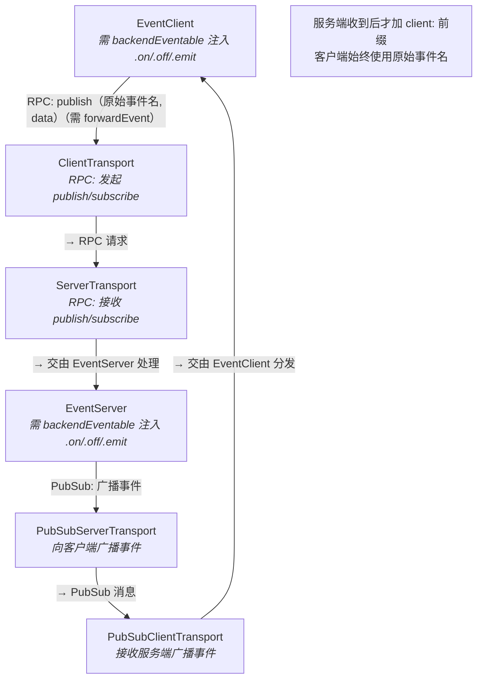
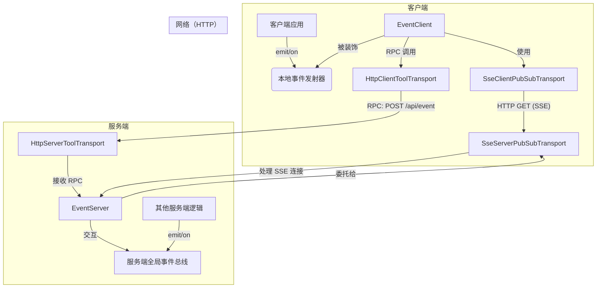

# 开发者指南：用 EventServer 与 EventClient 构建实时事件

> 【[English](./pubsub.md)|中文】

本指南全面介绍 `EventServer` 与 `EventClient` 系统——一套用于构建实时、双向通信通道的强大方案。它的核心架构建立在**可插拔的 PubSub 传输层**之上，因此与任何具体的通信协议完全解耦。只要提供一个兼容的传输实现，您就可以无缝使用服务器发送事件（SSE）、WebSockets、IPC 或任何其他协议。

**前置知识：** 本文假设您已经理解 `@isdk/tool-rpc` 的基础传输层——也就是承载控制平面的 RPC 传输。相关内容请参阅 `@isdk/tool-rpc` 的 transport 文档，此处不再重复解释。

## 核心概念：统一事件总线

本系统的首要目标，是创建一条贯穿服务端与客户端的、无缝的双向事件总线——让应用中的组件彼此解耦地通信。

它把**控制平面**与**数据平面**分开：

* 🛠️ **控制平面（RPC）**：客户端向服务端转发事件是**按事件逐个显式开启**的。调用 `eventClient.forwardEvent('event.name')` 即可为该事件开启转发。此后 `.emit('event.name', data)` 会自动触发一次 RPC 调用（经由主传输），发送的是**原始事件名**（例如 `'ui.click'`）。服务端在处理时**会自动加上 `client:` 前缀**（例如 `'client:ui.click'`），以避免命名冲突并强制命名空间隔离。
* 📡 **数据平面（PubSub）**：事件载荷——无论来自服务端，还是由服务端处理客户端事件后产生——都通过一个专用的、抽象的、可插拔的 PubSub 传输层异步投递给客户端。

关键特性是**可配置的事件转发**：

* 🔁 服务端可配置为监听其内部全局 `eventBus`，并把选定事件自动中继给已订阅的客户端（经由 PubSub）。
* 🔁 **客户端 → 服务端的事件转发需要两个互相独立、显式的开关：**
  1. **客户端侧**：调用 `eventClient.forwardEvent('event.name')`，为该事件开启 RPC 发布。
  2. **服务端侧**：设置 `EventServer.autoInjectToLocalBus = true`，允许收到的事件（在加上 `client:` 前缀之后）被发射到服务端内部事件总线。

    ```ts
    // 第 1 步：客户端为特定事件开启转发
    eventClient.forwardEvent('ui.click');

    // 第 2 步：服务端开启对客户端事件的加工
    EventServer.autoInjectToLocalBus = true;
    ```

    ⚠️ **重要**：事件处理方法（`.on()`、`.off()`、`.emit()` 等）**不是** `EventClient` 与 `EventServer` 的原生能力。它们的事件能力必须**通过 `backendEventable(...)` 函数注入**。在注入之前调用这些方法会得到一个 `TypeError`。

这一设计形成了一套强大而松耦合的架构：组件之间通过事件通信，彼此没有直接依赖，也无需关心位置透明性与传输细节。使用 AOP（`backendEventable`）注入能力，保证了最大的灵活性、可测试性与显式的 opt-in 行为。

```md
┌──────────────────────────────────────────────────────────────────────────────┐
│                                                                              │
│  ┌────────────────┐     uses        ┌─────────────────────┐                  │
│  │ EventClient    │ ──────────────▶ │ ClientTransport     │                  │
│  │ - InjectEmitter│  (RPC Call)     │ (HTTP/WebSocket RPC)│                  │
│  │ - forwardEvent │ ◀─────────────▶ │                     │                  │
│  └────────────────┘                 └────────┬────────────┘                  │
│                                              │  RPC: publish('my.event')     │
│                                              ▼                               │
│                                    ┌─────────────────────┐                   │
│                                    │ ServerTransport     │                   │
│                                    │ (HTTP/WebSocket RPC)│                   │
│                                    └──────────┬──────────┘                   │
│                                               │                              │
│                                               ▼                              │
│                                    ┌─────────────────────────────┐           │
│                                    │   EventServer               │           │
│                                    │ - Inject Emitter            │           │
│                                    │ - autoInjectToLocalBus      │           │
│                                    │     emit('client:ui.click') │           │
│                                    └──────────┬──────────────────┘           │
│                                               │  Broadcast                   │
│                                               ▼                              │
│                                    ┌─────────────────────┐                   │
│                                    │PubSubServerTransport│                   │
│                                    │ (WebSocket/MQTT)    │                   │
│                                    └──────────┬──────────┘                   │
│                                               │  PubSub Message              │
│                                               ▼                              │
│                                    ┌─────────────────────┐                   │
│                                    │PubSubClientTransport│                   │
│                                    │ (WebSocket/MQTT)    │                   │
│                                    └──────────┬──────────┘                   │
│                                               │  Deliver Message             │
│                                               ▼                              │
│                                    ┌───────────────────────┐                 │
│                                    │   EventClient         │                 │
│                                    │ → Receive and trigger │                 │
│                                    │   local events        │                 │
│                                    └───────────────────────┘                 │
│                                                                              │
└──────────────────────────────────────────────────────────────────────────────┘
```



### 面向切面编程（AoP）与事件发射器

一个关键概念是：`EventClient`（以及更广义的 `ClientTools`）可以被增强出事件发射器能力。借助 `events-ex` 这类库，您可以给客户端工具实例装上标准的 `on`、`off`、`emit` 方法。于是 `EventClient` 就能充当一条本地事件总线，并与服务端透明地保持同步。

> 💡 事件监听与发射能力是通过 AOP 风格的 `backendEventable(EventClient)` 函数注入到 `EventClient` 的，这让核心类保持与传输无关，也易于测试。

## 示例：HTTP 与服务器发送事件（SSE）

### 架构（SSE）

下图展示了使用本包自带的 SSE 传输时各组件如何协作。其他传输（如 WebSockets 或 IPC）遵循同样的模式。



### 服务端设置（SSE）

在服务端，您需要在 `EventServer` 类上设置所选的 PubSub 传输。当客户端请求 `eventServer` 的 `list` 端点时，`EventServer` 会把连接的处理委托给该传输。

```typescript
// 在服务端入口文件（例如 server.ts）中
import { EventServer, eventServer, SseServerPubSubTransport, sseCredentialReader } from '@isdk/tool-event';
import { HttpServerToolTransport, RpcSessionIdentityPolicy } from '@isdk/tool-rpc';

async function main() {
  // 两面共用一个身份策略：流请求本身就是一次普通 RPC 调用，所以传输层上的策略既决定这条
  // 流是谁，也决定后续 `$sub`/`$publish` 来自谁
  const identity = new RpcSessionIdentityPolicy();

  // **关键步骤：为服务端设置 PubSub 传输**
  EventServer.setPubSubTransport(new SseServerPubSubTransport({ revoke: (id) => identity.revoke(id) }));

  // 注册 eventServer 工具实例
  eventServer.register();

  const serverTransport = new HttpServerToolTransport({ identity, credentialReader: sseCredentialReader });
  // 发现（discovery）是挂在 RPC 前缀上的内置工具（`rpcApis`）：无需再注册
  serverTransport.addRpcHandler('/api');

  // ... 启动服务端
  await serverTransport.start({port: 3000})
}
```

### 客户端设置（SSE）

客户端的设置以简单、稳健为目标：先设置 `apiUrl`，再调用 `loadFrom()` 发现服务端工具，然后设置 PubSub 传输。`EventClient` 足够聪明，会自动用 `apiUrl` 配置好 PubSub 传输。

```typescript
// 在客户端代码中
import { EventClient, eventClient, SseClientPubSubTransport, backendEventable } from '@isdk/tool-event';
import { ClientTools } from '@isdk/tool-rpc';

async function main() {
  const apiRoot = 'http://localhost:3000/api';
  // 设置 apiUrl 并加载服务端工具定义
  ClientTools.apiUrl = apiRoot;
  await ClientTools.loadFrom();

  // **关键步骤 1：为客户端设置 PubSub 传输**
  // `setPubSubTransport` **必须**在 `apiUrl` 已经设置*之后*调用，
  // 因为正是这个 apiUrl 会被用来做自动配置。
  EventClient.setPubSubTransport(new SseClientPubSubTransport());

  // **关键步骤 2：让客户端具备事件能力**
  backendEventable(EventClient);
  eventClient.register();

  // 现在就可以用 eventClient.on、.off、.emit 与服务端交互了
}
```

> **ℹ️ SSE 客户端使用 [`eventsource`](https://github.com/EventSource/eventsource)，它在本包中声明为
> peer dependency（对等依赖）。**该实现与运行环境无关（它构建在 `fetch` + `eventsource-parser`
> 之上，不含任何 Node.js 专有 API），由此有三点是值得知道的：
>
> - **不会在 `globalThis.EventSource` 上安装任何东西。**传输层直接导入该类，因此浏览器与
>   Node.js 走的是完全相同的实现——不需要 polyfill 步骤，也没有需要保存或恢复的全局对象。
> - **包管理器会替您安装 peer dependency**，但如果您的安装流程会跳过它们（某些
>   monorepo/打包流程确实如此），请显式补上：`npm install eventsource`。
> - **正则订阅依赖它。**匹配发生在传输层内部、JS 可见的 `dispatchEvent` 里。浏览器内置的
>   `EventSource` 是在内部自行派发消息的，永远到不了这个钩子——这正是本包从不使用内置实现的原因。
>
> 如果您需要自己打开一条流，同一个类在 Node 与浏览器两个入口都重新导出为 `EventSource`：
>
> ```typescript
> import { EventSource } from '@isdk/tool-event'; // 或 '@isdk/tool-event/browser'
> const es = new EventSource('http://localhost:3000/api/event');
> es.addEventListener('my.event', (event) => console.log(event.data));
> ```

## 会话标识与续传（Session Identity and Resume）

一条 SSE 流是一个**会话（session）**，而不只是一条连接。服务端在 `welcome` 事件中下发该会话的
`clientId`，而每一次 `$sub` / `$publish` 调用都是针对该会话做匹配的——绝不会针对客户端自己塞进
载荷里的某个 id。这正是 `$publish` 返回的 `senderId` 可信的原因。

```typescript
// id 由服务端分配；客户端只是读取它，而不是选择它。
await eventClient.setActive(true)
console.log(eventClient.clientId) // 服务端分配，且跟随会话
```

一条掉线的流会带着 `welcome` 交还给它的续传凭证（`sessionToken`）重新打开，因此这次中断对客户端
毫无代价：`clientId` 不变，订阅表不变——包括流打开之后通过 RPC 追加的订阅——并且所有它尚未确认
的消息都会被重放。

```typescript
// 凭证搭在重开的流的 URL 里（`session_token`），因为 EventSource 既不能发请求头，
// 也不能在一条活动连接上改变 URL。客户端最后确认的那个事件 id 也一并带上
// （`last_event_id`），通道从那里开始重放。注册在流上的监听器会被重放到新连接上，
// 精确订阅与正则订阅一视同仁。
```

### 身份策略

一个接入请求属于谁，由 tool-rpc 的 `RpcIdentityPolicy` 决定，**每请求一次，在 RPC 传输层**：SSE 流本身就
是一次那样的请求（`EventServer.list`），因此流与后续的 `$sub`/`$unsub`/`$publish` 由同一个策略实例、对同一
张凭证解析。外部鉴权协议通过**替换**该策略接入；事件协议本身不做任何改动。

对流而言这个策略不是可选项：传输层没有解析出身份时，`EventServer.list` 会以 401 拒绝开流
（`SSE_IDENTITY_REQUIRED_MESSAGE`）——没有服务端定的 id 可以定位会话，而客户端自带的 `clientId` 永不被采用。

```typescript
import { RpcSessionIdentityPolicy } from '@isdk/tool-rpc';
import { sseCredentialReader } from '@isdk/tool-event';

const identity = new RpcSessionIdentityPolicy({ ttlMs: 30_000 });
const serverTransport = new HttpServerToolTransport({ identity, credentialReader: sseCredentialReader });
EventServer.setPubSubTransport(new SseServerPubSubTransport({
  revoke: (id) => identity.revoke(id), // 通道重置时抹掉该会话的凭证
}))
```

```typescript
interface RpcIdentityPolicy<Req = any> {
  readonly name?: string
  /** 该请求出示的凭证若为本策略签发，则返回其身份。 */
  match: (ctx: RpcIdentityContext<Req>) => RpcIdentity | undefined | Promise<RpcIdentity | undefined>
  /** 为新请求生成身份——连同它的 `credential`，即 `welcome` 交还的内容。 */
  assign: (ctx: RpcIdentityContext<Req>) => RpcIdentity | Promise<RpcIdentity>
  /** 丢弃某身份的凭证，例如其会话彻底结束时。 */
  revoke?: (identityId: string) => void | Promise<void>
}
```

两件事仍归传输层，因为 tool-rpc 有意不去命名它们：凭证的**wire 形态**（`sseCredentialReader` 读的
`session_token` query / `rpc-session-token` header，以及 `welcome` 里的 `sessionToken` 键），以及
**会话活性**（通道的 `resumeWindow`）。策略装在传输层并指向 `sseCredentialReader`，两面才认同一张凭证；
留着默认 reader，流上的 query 凭证对策略就是不可见的，每次重连都是新会话。

**跨域部署要自己放行这个请求头。** 控制面调用把凭证放在自定义请求头 `rpc-session-token` 里，而浏览器
只有在服务端把它列进 `Access-Control-Allow-Headers`（并正确应答 preflight）之后才会带上自定义头；
RPC 前缀前面的反向代理也要透传该头。这条失败是静默的：流照常工作（凭证走 `session_token` query，
CORS 管不到），而每个 `$sub` / `$unsub` / `$publish` 到达时不带凭证，各自解析成一个新会话。
同源部署（包括示例用的 dev-server 代理）什么都不用做。

默认策略（`RpcSessionIdentityPolicy`）在服务端生成 id，并发出一个与之绑定的不透明 token：重连时出示一个
已签发的 token 即可续传该会话；而服务端从未签发过的 token 解析结果为空——伪造的 id/token 永远选不到会话。
它接受 `{ ttlMs: 30_000 }`；每次凭证被出示，TTL 都会向前滑动（闲置的凭证会过期，活跃的不会）。`maxUses`
建议不设：控制面与数据面共用一张凭证后，每个 `$sub` 都是一次出示，设上限会把凭证花在 RPC 调用上。

### 续传调优

一个会话只有**一条活动流**：第二条携带该凭证的连接会接管这个会话（被它取代的那条流会关闭），
因此一次 publish 对每个 `clientId` 只投递一份。通道选项通过 `channelOptions` 传入：

```typescript
// 策略的选项在策略上，通道的选项在传输层上。
const identity = new RpcSessionIdentityPolicy({ ttlMs: 60_000 });
EventServer.setPubSubTransport(new SseServerPubSubTransport({
  revoke: (id) => identity.revoke(id),
  channelOptions: { resumeWindow: 30_000, maxStreamDuration: 30_000, historySize: 100 },
}))
```

| 选项 | 默认值 | 作用 |
|---|---|---|
| `resumeWindow` | 30s | 一个掉线的会话可以带着它的订阅表被续传多久。每次掉线、每次连接都会重新打开这个窗口，因此反复掉线的会话始终可续传；设为 `0` 则每次重连都变成新会话。 |
| `maxStreamDuration` | 30s | 服务端按定时器主动结束这条流。这就是一次普通的掉线：它会打开续传窗口，客户端续传同一个会话而察觉不到差别。设为 `0` 取消该限制。 |
| `historySize` | 100 | 重连最多可以回放到多久之前。重放覆盖自客户端确认过的那个 id 以来发布的所有消息，只要它们仍在该缓冲区里、并且匹配被续传会话的订阅表——包括会话**处于离线期间**发布的那些消息。 |
| `pingInterval` | 3000 | ping 帧的间隔。 |
| `clientRetryInterval` | 1000 | 发给客户端的 `retry:` 提示。 |
| `rewind` | 0 | 向*新*客户端发送的历史消息条数。 |

> ⚠️ **续用凭证只与签发它的策略一样强。**装了 `credentialReader: sseCredentialReader` 后，它就是两面共同
> 接受的那张凭证，因此值得当作凭证看待：`RpcSessionIdentityPolicy` 签发的随机不透明 token 只标识一个身份；
> 而一个校验鉴权服务签名 token 的策略，会把租户与 scope 带在 `identity.attributes` 里。两种情况下鉴权都在
> 事件协议之外——外部鉴权协议是替换策略，而不是扩展策略。

### 宣告“服务端结束的会话”（`$close`）

SSE 流断开并不等于会话结束。代理超时、`maxStreamDuration` 到期、被第二条连接接管，这些都是“掉线”：
客户端重连并续传同一个会话——这是正确答案。但当会话是**服务端**结束的（业务代码调用 `session.close()`，
或通道被重置），这个答案就错了：客户端会去续传一个已经不存在的会话，而它的流一直报告
`readyState === 1`，发着没人接收的事件。

`closeSignal` 让两端各自独立地启用这个通知：

```typescript
// 服务端：传输上的简写，等价于 `channelOptions: { closeSignal }`。
EventServer.setPubSubTransport(new SseServerPubSubTransport({
  revoke: (id) => identity.revoke(id),
  closeSignal: 'server',
}))

// 客户端：识别这帧。默认关闭，与服务端的开关成对。
EventClient.setPubSubTransport(new SseClientPubSubTransport({ closeSignal: true }))
```

| `closeSignal` | 宣告什么 |
|---|---|
| `false`（默认） | 什么都不发。字节流与旧版本完全一致：流的任何结束都被当作掉线，客户端照常续传。 |
| `'server'` | `session.close()` 结束会话时发一帧 `$close`（`{ reason }`）。掉线永远不发——掉线会打开续传窗口，在那里发关闭帧等于结束一个本该被续传的会话。 |
| `'server+reset'` | 通道重置时也发（`clearClients()`，例如凭证被 revoke）——此时续传没有未来。 |

对想自己写传输的人来说，这帧有两个细节：

- **帧名是 `$close`**，与 `$sub` / `$unsub` / `$publish` 同一个控制面前缀。SSE 上这帧与应用事件共享同一个
  事件命名空间，裸的 `close` 会让一个同名的业务事件被误判成会话关闭。
- **它直接写进响应，绝不走 `publish()`**，也不带 `id:` 行。发布出去的帧会进入重放历史，而没有订阅表的
  客户端重连时会重放*全部*历史——那条旧的关闭帧会让它停止重连。

启用后的客户端收到这帧就关闭自己的流：`readyState` 变为 `2`（CLOSED），`closeReason` 说明原因
（`server`、`transport-cleanup`……），不再尝试重连，`send()` 停止。任一侧不开就保持原有行为：服务端向
未启用的客户端发一帧没人监听的事件；启用的客户端对着不发帧的服务端，只是永远收不到。

Electron 不需要开关：`@isdk/tool-electron` 一直在自己的 `pubsub-close:{namespace}` 通道上宣告同一件事，
因为通道命名空间已经把它挡在应用事件名之外。名字与原因只定义一处——`transports/pubsub/close`
（`PubSubCloseEvent`、`PubSubSessionCloseReason`、`PubSubStreamRegistry`）；传输自己只决定这帧怎么走，
不决定它说什么。

## 示例：用 Electron IPC 构建实时桌面应用

对于用 Electron 构建的桌面应用，事件系统可以跑在内置的进程间通信（IPC）通道上。它能在您的应用外壳内提供一套高效的实时后端，而无需 HTTP 服务端。

> 📦 这些传输位于独立的包 **`@isdk/tool-electron`** 中（`npm install @isdk/tool-electron`；`electron` 是 peer dependency）。它们实现的是来自 `@isdk/tool-event` 的 `IPubSubServerTransport` / `IPubSubClientTransport` 接口，因此 `EventServer` / `EventClient` 内部无需任何改动。
>
> 请按进程选择导入入口：
>
> - **`@isdk/tool-electron/server`** —— 仅主进程。导出 `IpcServerToolTransport` 与 `ElectronServerPubSubTransport`，并且刻意不导入 `ipcRenderer`，这样主进程的打包产物保持干净。
> - **`@isdk/tool-electron`** —— 渲染进程/预加载。导出 `IpcClientToolTransport` 与 `ElectronClientPubSubTransport`（同时也导出服务端那些类）。
>
> 通道名由 `electron://` 形式的 `apiUrl` 推导：`'electron://my-app'` → 命名空间 `my-app` → 通道 `my-app:discover` 与 `my-app:rpc`。裸命名空间（`'my-app'`）同样接受；`electron://` 形式是约定写法。

下面覆盖两个场景：只用 IPC 做 Pub/Sub，以及 RPC 与 Pub/Sub 全部走 IPC 的完整集成方案。

### 场景 1：仅 Pub/Sub 走 IPC

如果您只需要一层实时事件，或者您的主 RPC 通信使用另一种传输（例如 HTTP），这个方案就很合适。它直接驱动传输层；此处用不了 `EventClient` 的 API（`subscribe` / `unsubscribe` / `publish`），因为那些是 RPC 调用，而本场景没有搭建任何 RPC 传输。

#### 主进程设置（`main.ts`）

您只需要设置 `ElectronServerPubSubTransport` 并让它开始监听。

```typescript
// 在 Electron 主进程中（例如 main.ts）
import { EventServer } from '@isdk/tool-event';
import { ElectronServerPubSubTransport } from '@isdk/tool-electron/server';

// 1. 为 pub/sub 通道定义一个唯一命名空间。
const pubSubNamespace = 'electron://my-app-events';

// 2. 创建服务端传输实例。
const serverTransport = new ElectronServerPubSubTransport(pubSubNamespace);

// 3. 为全局 EventServer 设置该传输。
EventServer.setPubSubTransport(serverTransport);

// 4. **关键步骤：激活该传输的 IPC 监听器。**
serverTransport.listen();

// 现在 EventServer 已就绪。您可以在主进程的任何位置发布事件，
// 它们会被发送给已订阅的渲染进程。
console.log('[Main] Pub/Sub transport listening...');
setInterval(() => {
  EventServer.publish('server-tick', { timestamp: Date.now() });
}, 5000);
```

#### 渲染进程设置（`renderer.ts`）

这里**直接**使用传输层。`eventClient.subscribe()` 是一次 RPC 调用（它对应控制平面上的 `$sub`），因此需要场景 2 里的 RPC 传输——在没有 RPC 的情况下，请自行驱动这条流：

```typescript
// 在客户端代码中（例如 renderer.ts）
import { ElectronClientPubSubTransport } from '@isdk/tool-electron';

// 1. 使用与服务端相同的命名空间。
const pubSubNamespace = 'electron://my-app-events';

// 2. **关键步骤：把命名空间交给传输层。**
// IPC 通道名由它推导，所以没有命名空间就无法创建传输。请把它传给构造函数——
// 另一种写法（在 `setPubSubTransport` *之前*设置 `EventClient.apiUrl`）只有在这个
// 顺序下才有效：`setPubSubTransport` 会通过 `setApiRoot` 把 apiUrl 转发给传输；
// 而事后才设置的 apiUrl，到达的是一个已经推导完（缺失）通道的传输。
const pubsub = new ElectronClientPubSubTransport(pubSubNamespace);

// 3. 打开流并监听。
const stream = pubsub.connect(pubSubNamespace);

stream.on('server-tick', (data) => {
  console.log('收到来自主进程的 tick:', data);
  document.body.innerHTML = `Tick received at: ${data.timestamp}`;
});
```

> **关于安全性**：这个极简示例假设 `contextIsolation` 是关闭的——它直接使用了原始 `ipcRenderer`。
> 对于现代的、安全的 Electron 应用，请看下面的集成示例，它注入了一个 `preload.js` 桥。

### 场景 2：RPC 与 Pub/Sub 全部走 IPC

这是 Electron 应用推荐的原生完整方案。它在同一套高效的 IPC 基础之上同时提供请求-响应（RPC）与实时事件。这需要一个 `preload.js` 脚本，在主进程与渲染进程之间安全地架桥。

#### 第 1 部分：预加载脚本（`preload.ts`）

这个脚本充当安全桥，只向渲染进程暴露必要的 IPC 函数。您的 `BrowserWindow` 的 webPreferences 应指向这个文件。

```typescript
// preload.ts
import { contextBridge, ipcRenderer, IpcRendererEvent } from 'electron';

// 定义将通过 `window.electronApi` 暴露给渲染进程的 API
const electronApi = {
  // 供 RPC 使用（invoke/handle）
  invoke: (channel: string, ...args: any[]) => ipcRenderer.invoke(channel, ...args),

  // 供 Pub/Sub 使用（send/on）
  send: (channel: string, ...args: any[]) => ipcRenderer.send(channel, ...args),
  on: (channel: string, listener: (event: IpcRendererEvent, ...args: any[]) => void) => {
    ipcRenderer.on(channel, listener);
  },
  off: (channel: string, listener: (...args: any[]) => void) => {
    ipcRenderer.removeListener(channel, listener);
  },
};

// 把 API 安全地暴露到渲染进程的 window 对象上
contextBridge.exposeInMainWorld('electronApi', electronApi);

// 可选：为暴露出的 API 定义类型，获得更好的 TypeScript 支持
export type ElectronApi = typeof electronApi;
```

#### 第 2 部分：主进程设置（`main.ts`）

这里同时设置用于 RPC 的 `IpcServerToolTransport` 与用于 Pub/Sub 的 `ElectronServerPubSubTransport`。

```typescript
// main.ts
import { EventServer, eventServer } from '@isdk/tool-event';
import {
  IpcServerToolTransport,
  ElectronServerPubSubTransport,
} from '@isdk/tool-electron/server';

// RPC 与 Pub/Sub 使用各自独立的命名空间；两者都是 `electron://` URI。
const rpcUrl = 'electron://my-app';
const pubSubUrl = 'electron://my-app-events';

// --- 1. 为标准 RPC 设置 IPC ---
// 这会为 'my-app:discover' 与 'my-app:rpc' 注册处理器。
const rpcTransport = new IpcServerToolTransport({ apiUrl: rpcUrl });
rpcTransport.addRpcHandler(rpcUrl);
// 发现是挂在 RPC 命名空间上的内置工具（`rpcApis`）：无需再注册
await rpcTransport.start();
console.log(`[Main] RPC transport started on ${rpcTransport.getListenAddr()}`);

// --- 2. 为 Pub/Sub 设置 IPC ---
const pubsubTransport = new ElectronServerPubSubTransport(pubSubUrl);
EventServer.setPubSubTransport(pubsubTransport);
pubsubTransport.listen(); // 激活 pub/sub 监听器
console.log(`[Main] Pub/Sub transport listening on ${pubSubUrl}`);

// --- 3. 注册工具 ---
// 注册 eventServer，使其方法（sub、unsub）可以通过 RPC 被调用
eventServer.register();
```

> `stop()` 会移除**该传输绑定的全部** IPC 通道，并释放它的路由登记。跳过它，下一个启动在同一个
> `electron://` 地址上会报出 `Routing Conflict`。

#### 第 3 部分：渲染进程设置（`renderer.ts`）

渲染进程使用预加载脚本暴露的 `electronApi`。两个传输都**以选项形式**接受这个桥——它们调用
`bridge.invoke` / `bridge.on` / `bridge.send`，而不是导入 `ipcRenderer`——因此不需要任何包装子类。

```typescript
// renderer.ts
import { EventClient, eventClient, backendEventable } from '@isdk/tool-event';
import { ClientTools } from '@isdk/tool-rpc';
import {
  IpcClientToolTransport,
  ElectronClientPubSubTransport,
  type Bridge,
  type PubSubBridge,
} from '@isdk/tool-electron';
import type { ElectronApi } from './preload';

// 把桥接后的 API 声明到 window 对象上，供 TypeScript 使用
declare global {
  interface Window { electronApi: ElectronApi; }
}

async function main() {
  const rpcUrl = 'electron://my-app';
  const pubSubUrl = 'electron://my-app-events';

  // 同一个桥接对象即可满足两种形态：`Bridge` 需要 `invoke`，
  // `PubSubBridge` 需要 `on` / `off` / `send`。
  const bridge: Bridge = window.electronApi;
  const pubsubBridge: PubSubBridge = window.electronApi;

  // --- 1. RPC 经由桥 ---
  const rpcTransport = new IpcClientToolTransport(rpcUrl, { bridge });
  rpcTransport.mount(ClientTools); // 把传输及其 apiUrl 挂载到 ClientTools 上
  await ClientTools.loadFrom();

  // --- 2. Pub/Sub 经由桥 ---
  // 命名空间传给构造函数（第 2 个参数才是桥——不是第 1 个：
  // 把桥作为第 1 个参数传入，它就会被当成 apiRoot）。
  EventClient.setPubSubTransport(
    new ElectronClientPubSubTransport(pubSubUrl, { bridge: pubsubBridge }),
  );

  backendEventable(EventClient);
  eventClient.register();

  // 现在 RPC 与 Pub/Sub 可以无缝、安全地一起使用了！
  await eventClient.subscribe('server-time');
  eventClient.on('server-time', (name, data) => {
    console.log('收到来自服务端的当前时间:', data);
  });
}

main();
```

> ⚠️ **模式（正则）订阅不会经由 Electron 传输投递。**
> `ElectronClientPubSubTransport` 没有实现 `addRegExEventListener`，因此在该传输上的正则订阅
> 会被服务端接受、每个模式告警一次、并在本地被跳过（见
> [模式（正则）订阅](#模式正则订阅)）。请使用精确事件名，或使用实现了正则那一对方法的传输。

---

## 通用用法（与传输无关）

设置完成后，使用事件总线的 API 与底层传输无关，完全一致。

### 转发与发布事件（服务端）

从服务端向客户端发送事件有两条路径：经由全局 `eventBus`（标准方式），或直接向传输层发布（进阶方式）。

#### 标准方式：从事件总线转发

最常用、也是推荐的方式，是在全局 `eventBus` 上发射事件。您可以配置 `eventServer` 自动监听这条总线上的特定事件，并把它们转发给已订阅的客户端。这形成了一套干净、解耦的架构。

```typescript
import { eventServer } from '@isdk/tool-event';
import { event } from '@isdk/tool-event'; // 全局事件总线

const eventBus = event.runSync();

// 1. 配置服务端转发哪些事件。
eventServer.forward(['user-updated', 'item-added']);

// 2. 现在，服务端的其他任何部分只需在总线上发射事件即可。
function updateUser(user: any) {
  eventBus.emit('user-updated', { userId: user.id, status: 'active' });
}
```

#### 进阶方式：直接向传输层发布

在某些需要绕过全局 `eventBus`、把事件直接送到传输层的特殊场景下，可以使用静态方法 `EventServer.publish()`。

这是一个进阶特性。要让它正确工作，客户端必须已经在传输层显式登记了对该事件的兴趣，通常通过 `eventClient.init(['event-name'])` 完成。

```typescript
import { EventServer } from '@isdk/tool-event';

// 签名为：`publish(event: string, data: any, target?: { clientId: string | string[] })`。

// 1. 广播给所有用 init() 订阅了 'broadcast-message' 的客户端。
function sendBroadcast() {
    EventServer.publish('broadcast-message', { message: '服务端即将重启！' });
}

// 2. 定向发送给某个特定客户端。
function sendDirectMessage(clientId: string, message: string) {
    const target = { clientId };
    EventServer.publish('private-message', { text: message }, target);
}
```

### 在服务端接收并区分事件

本事件系统的一个关键设计，是把服务端内部逻辑产生的事件与客户端发布的事件清晰、安全地分开。实现方式是给所有客户端发起的事件自动加上 `client:` 前缀。

这一机制防止客户端意外地或恶意地触发敏感的内部事件，也让服务端插件可以专注于业务逻辑，而无需逐个事件手工判断来源。

#### 启用/禁用客户端事件转发

默认情况下，客户端发布的事件**不会**被转发到服务端内部事件总线。这是一种安全优先的做法，可避免不期望的副作用。

要启用该特性，您必须在服务端设置过程中把静态属性 `autoInjectToLocalBus` 置为 `true`。

```typescript
// 在服务端入口文件中
import { EventServer } from '@isdk/tool-event';

// 置为 true，允许客户端事件被发射到服务端总线上。
EventServer.autoInjectToLocalBus = true;
```

只有当它被设为 `true` 时，服务端才会在内部总线上发射带 `client:` 前缀的事件。

#### 示例 1：监听服务端内部事件

这是监听服务端自身工作流中的事件的标准做法。这个监听器**永远不会**被客户端发布的同名事件触发。

```typescript
import { event } from '@isdk/tool-event';
const eventBus = event.runSync();

// 监听只由服务端逻辑触发的事件。
// 例如：eventBus.emit('data-updated', { id: 123 });
eventBus.on('data-updated', (data) => {
  console.log('内部数据已更新，正在刷新缓存……');
  // ……纯内部业务逻辑
});
```

#### 示例 2：监听客户端发起的事件

要对客户端发布的事件作出响应，您必须显式监听带 `client:` 前缀的事件名。该监听器还会收到一个元数据对象，其中携带该事件来自哪个会话。

```typescript
import { event } from '@isdk/tool-event';
const eventBus = event.runSync();

// 客户端这样发布一个事件：
// eventClient.publish({ event: 'user-action', data: { ... } });

// 服务端监听器必须使用 'client:' 前缀。
eventBus.on('client:user-action', (data, meta) => {
  // meta 是 `{ event, sender }`：`event` 是原始（未加前缀）的事件名，
  // `sender` 是服务端为这次请求解析出的传输会话。
  // 可信的 clientId 挂在会话上——不在 meta 本身。
  const clientId = meta?.sender?.clientId;
  console.log(`用户 ${clientId} 执行了一个操作，数据：`, data);
  // ……处理客户端交互的逻辑
});
```

> `sender` 是会话对象，因此当这次请求没有可解析的会话时它是 `undefined`（`getSessionFromIdentity` 与
> `getSessionFromReq` 都没实现的传输，或不曾经由任何流到达的调用）。读取 `clientId` 之前请先做判空。

### 订阅、监听与发布（客户端）

```typescript
// **订阅并监听**
await eventClient.subscribe(['user-updated', 'broadcast-message']);

eventClient.on('user-updated', (name: string, data: any) => {
  console.log('服务端上有用户更新了！', data);
});

// **向服务端发布事件**
// 这会把事件发送到服务端。在服务端内部事件总线上，它会被加前缀并以
// 'client:client-action' 发射；其他客户端收到的则是原始的 'client-action'。
eventClient.publish({
    event: 'client-action',
    data: { action: 'button-click', value: 123 }
});

// **转发客户端事件（推荐）**
eventClient.forwardEvent(['user-settings-changed']);

function onSettingsSave(newSettings: any) {
    // 这会在本地事件总线上发射该事件。由于它已被转发，
    // 它同时也会被发布到服务端。
    eventClient.emit('user-settings-changed', newSettings);
}
```

### 模式（正则）订阅

每一个订阅 API 都同时接受模式与普通事件名，于是一次订阅就能覆盖一整族事件。模式在服务端（`forward` / `unforward`）与客户端（`subscribe` / `unsubscribe`、`on` / `off`）上的行为完全一致。

```typescript
// 字符串形式的正则——与 events-ex 使用的 `/source/flags` 语法相同。
eventServer.forward(['/^user-.*/', '/^log-(error|warning)$/i'])

// RegExp 对象同样接受。
eventServer.forward([/^order-/])

await eventClient.subscribe(['/^user-.*/'])
eventClient.on('/^user-.*/', (name: string, data: any) => console.log(name, data))
```

**`forwardEvent` / `unforwardEvent` 是例外。**它们的签名是 `string | string[]`，因此传入 `RegExp`
参数是一个类型错误（`Type 'RegExp' is not assignable to type 'string'`）。字符串形式的模式确实能到
达本地总线——转发是通过被注入的 `on()` 注册的，而 `on()` 接受 `/source/flags`——但**不推荐**如
此使用，因为回环保护 `_forwardEvents.has(evtType)` 是拿*模式文本*去比对*真实事件名*，永远匹配不
上。于是被转发的事件一旦被服务端广播回来，就会在本地重投一次、再次向上转发、再次被广播：形成失控
的回声。请转发精确事件名；如果上行方向需要模式匹配，请单独注册该模式。

```typescript
eventClient.forwardEvent(['user-settings-changed']) // ✅ 精确事件名
eventClient.forwardEvent(['/^user-settings-.*/'])    // ⚠️ 可用，但会产生回声（见上）
eventClient.forwardEvent([/^user-settings-.*/])      // ❌ 类型错误
```

**什么算作模式。**一个字符串只有在以 `/` 开头、以 `/` 结尾（可带 flags）、并且能解析为合法模式时
才被当作正则——所以 `'/[/'`（非法 source）、`'/'` 与 `'//'` 仍是普通事件名。带 flags 的空 source
（`'//i'`）**确实**算模式，并且会匹配所有事件；请不要在无意中写出它。一个字符串与由同一 source
构造出的正则是同一个订阅：它们共享同一个键，彼此去重。

**Flags。**`i`、`m`、`s`、`u`、`d` 均被尊重。`g` 与 `y` 在匹配时会被丢弃，因为在这两个 flag 下
`RegExp.prototype.test` 会推进 `lastIndex`，订阅就会跳过每隔一个事件。

**投递是去重的。**当一个精确名与一个覆盖它的正则同时被订阅时，事件只投递**一次**——在服务端
（对传输发布一次）以及在客户端（调用监听器一次）——无论谁先订阅。取消那个覆盖用的正则，精确订阅会
自动恢复。

**转发按类登记。**`forward()` 注册在您调用的那个类上，因此子类（`class MyServer extends
EventServer`）拥有自己的转发登记表，绝不会取消 `EventServer` 的订阅，反之亦然。

**传输支持。**正则订阅要求客户端流实现 `addRegExEventListener`。内置的 SSE 传输实现了它。省略它的
自定义传输会记录一条告警，指明事件名与该传输的 protocol，并且该订阅会被跳过，而不是被静默丢弃。

这套与传输无关的架构，为构建实时、交互式应用提供了一条清晰、强大且解耦的路径。把事件逻辑与通信协议分离之后，您可以选择最适合需求的传输，同时保持一致、统一的事件模型。

---

## 实现自定义 PubSub 传输

对于需要接入另一种消息协议（例如 WebSockets、MQTT）的开发者，您可以通过实现服务端与客户端的 PubSub 接口来创建自己的传输。

### 服务端：`IPubSubServerTransport`

服务端实现负责管理客户端连接并广播事件。您实现来自 `@isdk/tool-event` 的 `IPubSubServerTransport` 接口。

该接口交还的会话对象是契约的一部分：

```typescript
export type PubSubClientId = string;

export interface PubSubServerSession {
  /** 本会话的 id，由传输在连接时生成。 */
  id: string;
  /** 本会话所匹配的 client id（`$sub` / `$publish` 都解析到它）。 */
  clientId?: PubSubClientId;
  /** 本会话的协议，例如 'sse'、'ws'、'ipc'、'electron'。 */
  protocol: 'sse' | 'ws' | 'ipc' | string;
  /** 向本会话的客户端发送一个事件与数据。 */
  send: (event: string, data: any, ctx?: PubSubCtx) => void;
  /** 关闭本会话的连接。 */
  close: () => void;
  /** 底层原始句柄（Node 的 `ServerResponse`、WebSocket……）。请谨慎使用。 */
  raw?: any;
}
```

核心接口定义如下：

```typescript
export interface IPubSubServerTransport {
  readonly name: string;
  readonly protocol: string;

  /**
   * 接入一个客户端，建立一条持久通信通道。
   *
   * 该方法被设计为通用的。传输特有的细节，例如 HTTP 的请求/响应对象，
   * 通过 `options` 参数传入。
   *
   * @param options 传输特有参数的容器。
   * @returns 表示新接入客户端的 `PubSubServerSession` 对象。
   */
  connect: (
    options?: {
      req: any; // 例如 http.IncomingMessage
      res: any; // 例如 http.ServerResponse
      clientId?: string;
      events?: string[];
      [k: string]: any;
    }
  ) => PubSubServerSession;

  /**
   * 让一个客户端会话订阅一个或多个事件。
   */
  subscribe: (session: PubSubServerSession, events: string[]) => void;

  /**
   * 让一个客户端会话取消订阅一个或多个事件。
   */
  unsubscribe: (session: PubSubServerSession, events: string[]) => void;

  /**
   * 由服务端向客户端发布一个事件。
   */
  publish: (
    event: string,
    data: any,
    target?: { clientId?: string | string[] },
    ctx?: PubSubCtx
  ) => void;

  /**
   * 注册新客户端连接的回调。
   */
  onConnection: (cb: (session: PubSubServerSession) => void) => void;

  /**
   * 注册客户端断开的回调。
   */
  onDisconnect: (cb: (session: PubSubServerSession) => void) => void;

  /**
   * 可选。供双向传输（例如 WebSockets）处理从客户端收到的消息。
   */
  onMessage?: (
    cb: (session: PubSubServerSession, event: string, data: any, ctx?: PubSubCtx) => void
  ) => void;

  /**
   * 查找属于“RPC 传输层的策略为本次请求解析出的那个身份”的会话（`ctx.identity.id`）。`$sub`、`$unsub`
   * 与 `$publish` 应当走这个查找：id 由服务端定，客户端无法把自己的调用指向别人的会话。
   */
  getSessionFromIdentity?: (identityId?: string) => PubSubServerSession | undefined;

  /**
   * @deprecated 读的是请求自带的 id，而身份策略存在的理由正是不再信任它。仅为不装策略的传输保留。
   */
  getSessionFromReq?: (req: any) => PubSubServerSession | undefined;
}
```

实现该接口后，您的自定义传输就可以通过 `EventServer.setPubSubTransport(new YourCustomTransport())` 直接插入 `EventServer`。

### 客户端：`IPubSubClientTransport`

客户端实现负责建立到服务端的连接并接收事件。它由来自 `@isdk/tool-event` 的 `IPubSubClientTransport` 接口定义。

核心接口定义如下：

```typescript
export interface IPubSubClientTransport {
  /**
   * 建立到某个服务端端点的连接。
   * @param url 端点路径，相对于该传输上配置的 `apiRoot`。为进阶用法或兼容性考虑，这里也可以是完整的绝对 URL。
   * @param params 可选的连接参数，例如初始的事件订阅。
   * @returns 表示该连接的 `PubSubClientStream` 实例。
   */
  connect: (url: string, params?: any) => PubSubClientStream | Promise<PubSubClientStream>;

  /**
   * 可选。断开指定流。
   */
  disconnect?: (stream: PubSubClientStream) => void;

  /**
   * 可选。用基础 URL 配置该传输。
   * 若实现该方法，传输就能解析传给 `connect` 方法的相对路径。
   * 它由 `EventClient.setPubSubTransport` 自动调用。
   * @param apiRoot API 的基础 URL。
   */
  setApiRoot?: (apiRoot: string) => void;
}
```

`connect` 返回的流必须实现用于精确事件名的 `on`/`off`；如果要支持[模式订阅](#模式正则订阅)，还需
实现可选的正则那一对方法：

```typescript
interface PubSubClientStream {
  /** 必填。本次连接的会话 id。`EventClient` 把它作为 `clientId` 暴露，并复制进 RPC
   *  header，于是 `$sub`/`$publish` 匹配的是服务端签发的那个会话——绝不是客户端自选的 id。 */
  clientId: string;

  /** 必填。本流的协议（'sse'、'ws'、'ipc'、'electron'……）。
   *  正则不受支持的那条告警里点名的就是它。 */
  protocol: 'sse' | 'ws' | 'ipc' | string;

  /** 可选。0 连接中，1 已打开，2 已关闭。`EventClient` 把 2 视为已关闭，
   *  并按需重开这条流。 */
  readyState?: number;

  // ……on / off / close

  /** 可选。仅用于双向传输（WS/IPC）；SSE 没有上行通道。 */
  send?: (event: string, data: any, ctx?: PubSubCtx) => void;

  /** 为 RegExp 或字符串形式的正则（'/^user-.*/'）注册监听器。
   *  可选：在未实现该方法的流上建立正则订阅时，EventClient 会对每个模式告警一次。 */
  addRegExEventListener?: (
    pattern: string | RegExp,
    listener: (data: any, ctx?: PubSubCtx) => void
  ) => void;

  /** 移除由 `addRegExEventListener` 注册的监听器，以同一模式（其 source 文本）
   *  与同一监听器函数为键。 */
  removeRegExEventListener?: (
    pattern: string | RegExp,
    listener: (data: any, ctx?: PubSubCtx) => void
  ) => void;
}
```

实现应当使用 `pattern.test(eventName)` 做匹配，且该 pattern 的 `g` 与 `y` flags 已被剥离（见
`src/utils/event-pattern.ts` 中的 `toEventMatcher`），这样带全局 flag 的模式对每个匹配事件都仍然触
发一次；并且应当保护监听器调用，使一个抛异常的监听器无法把连接拆掉。

`EventClient` 会自动处理 `apiRoot` 配置，这让整套系统很好用。`connect` 方法是最关键的部分，因为它
把 `EventClient` 与"连接具体怎么建立"的细节解耦开来。

> **顺序很重要。**`EventClient.setPubSubTransport` **只有在 `EventClient.apiUrl` 已经设置时**才会
> 调用传输上的 `setApiRoot(apiUrl)`——事后才赋值的 apiUrl，到达的是一个从未拿到过 root 的传输。
> 请先设置 `apiUrl`，或者让传输在自己的构造函数里接收 root。

实现这两个接口之后，您就可以在所选协议之上启用整套实时事件系统。

### 自定义传输能继承什么、必须自己补什么

有两个行为位于 `EventServer` / `EventClient` 内部，因此自定义传输可以免费获得：模式匹配与去重由客户端/服务端的记账驱动；客户端发起事件的 `client:` 前缀由 `EventServer` 施加。

有三个**不**包含在内，属于传输自身的责任：

- **模式投递。**`EventServer` 把匹配到的事件交给 `publish()`；只有流上的 `addRegExEventListener`
  才能让客户端对每个事件调用**一个**监听器。省略它，模式订阅会告警一次并被跳过。
- **会话续传。**SSE 传输在 `welcome` 中签发凭证，带着它重开掉线的流，重放监听器，并保持每个会话
  恰好一条活动流。不实现这一点的传输，每次掉线都会失去会话：新的 `clientId`，以及一份从重连 URL
  重建的订阅表——也就是*首次*连接时的那份列表，于是此后追加的订阅会静默丢失。双向传输可以在自己
  的通道上续传（不受 URL 约束）；单向传输必须把凭证带进连接参数里，正如 SSE 的做法。
- **宣告服务端结束的会话。**`EventServer` 调用 `session.close()`；只有传输能告诉客户端“你的会话结束了”，
  否则那条客户端的流会一直停在 `readyState === 1`，向一个已经不存在的会话发送。词汇是共享的——
  `PubSubCloseEvent`、`PubSubSessionCloseReason`——客户端侧的分发也是：`PubSubStreamRegistry` 持有
  一个客户端传输名下的所有流，因此一次通知能关闭它们全部。每个传输要提供的只是走法：自己的通道
  （Electron 的 `pubsub-close:{ns}`，始终如此）或流上的一帧（SSE 的 `$close`，需显式启用）。

### 未设置传输时

两侧的失败方式不同，而且都不响亮：

- `EventServer.pubSubTransport` 记录 `EventServer pubSubTransport not set` 并返回 `undefined`——
  `publish()` 是一次静默的 no-op。`list` / `$sub` / `$unsub` 这几个 RPC 调用确实会抛
  `NotImplemented`。
- `EventClient.pubSubTransport` 抛出 `EventClient pubSubTransport not set`。
