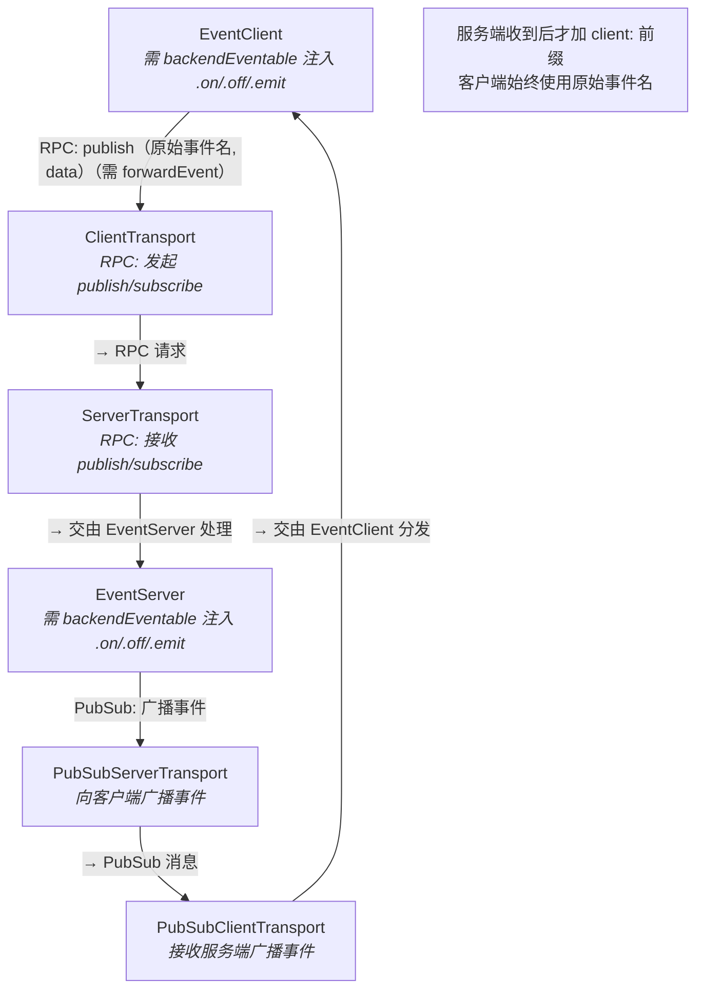
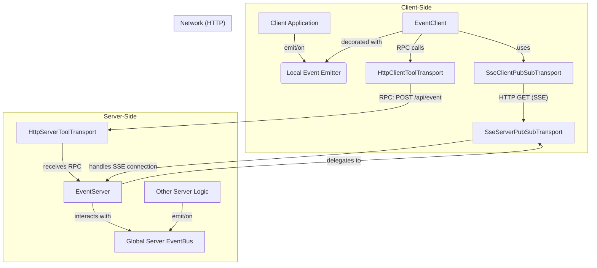

# Developer's Guide: Real-time Events with EventServer & EventClient

> 【English|[中文](./pubsub.cn.md)】

This guide provides a comprehensive overview of the `EventServer` and `EventClient` system, a powerful solution for building real-time, bidirectional communication channels. Its core architecture is built on a **pluggable PubSub transport layer**, making it completely independent of any specific communication protocol. You can seamlessly use Server-Sent Events (SSE), WebSockets, IPC, or any other protocol by simply providing a compatible transport implementation.

**Prerequisite:** This document assumes you understand the base transport layer of `@isdk/tool-rpc` — the RPC transport that carries the control plane. See the transport documentation of `@isdk/tool-rpc`; it is not re-explained here.

## Core Concept: The Unified Event Bus

The primary goal of this system is to create a seamless, bidirectional event bus that spans server and client — enabling decoupled communication across your application.

It separates **control** and **data** planes:

* 🛠️ **Control Plane (RPC)**: Client-to-server event forwarding is **opt-in per event**. Call `eventClient.forwardEvent('event.name')` to enable it. Afterwards, `.emit('event.name', data)` automatically triggers an RPC call (via primary transport), sending the **original event name** (e.g., `'ui.click'`). The server **automatically prefixes it with `client:`** (e.g., `'client:ui.click'`) when processing, to avoid naming conflicts and enforce namespace isolation.
* 📡 **Data Plane (PubSub)**: Event payloads — whether originating from the server or resulting from client events processed by the server — are delivered asynchronously to clients via a dedicated, abstract, pluggable PubSub transport.

The key feature is **configurable event forwarding**:

* 🔁 The server can be configured to listen to its internal global `eventBus` and automatically relay selected events to subscribed clients via PubSub.
* 🔁 **Client → Server event forwarding requires two explicit, independent opt-ins:**
  1. **Client-side**: Call `eventClient.forwardEvent('event.name')` to enable RPC publishing for that specific event.
  2. **Server-side**: Set `EventServer.autoInjectToLocalBus = true` to allow received events (after being prefixed with `client:`) to be emitted on the server’s internal event bus.

    ```ts
    // Step 1: Client enables forwarding for a specific event
    eventClient.forwardEvent('ui.click');

    // Step 2: Server enables processing of client-originated events
    EventServer.autoInjectToLocalBus = true;
    ```

    ⚠️ **Important**: The event handling methods (`.on()`, `.off()`, `.emit()` etc) are **not native** to `EventClient` and `EventServer`. Their event capabilities must be **injected via the `backendEventable(...)` function**. Attempting to call these methods before injection will result in a `TypeError`.

This design creates a powerful, loosely-coupled architecture where components communicate through events without direct dependencies, location transparency, or transport concerns. The use of AOP (backendEventable) for capability injection ensures maximum flexibility, testability, and explicit opt-in behavior.

```md
┌──────────────────────────────────────────────────────────────────────────────┐
│                                                                              │
│  ┌────────────────┐     uses        ┌─────────────────────┐                  │
│  │ EventClient    │ ──────────────▶ │ ClientTransport     │                  │
│  │ - InjectEmitter│  (RPC Call)     │ (HTTP/WebSocket RPC)│                  │
│  │ - forwardEvent │ ◀─────────────▶ │                     │                  │
│  └────────────────┘                 └────────┬────────────┘                  │
│                                              │  RPC: publish('my.event')     │
│                                              ▼                               │
│                                    ┌─────────────────────┐                   │
│                                    │ ServerTransport     │                   │
│                                    │ (HTTP/WebSocket RPC)│                   │
│                                    └──────────┬──────────┘                   │
│                                               │                              │
│                                               ▼                              │
│                                    ┌─────────────────────────────┐           │
│                                    │   EventServer               │           │
│                                    │ - Inject Emitter            │           │
│                                    │ - autoInjectToLocalBus      │           │
│                                    │     emit('client:ui.click') │           │
│                                    └──────────┬──────────────────┘           │
│                                               │  Broadcast                   │
│                                               ▼                              │
│                                    ┌─────────────────────┐                   │
│                                    │PubSubServerTransport│                   │
│                                    │ (WebSocket/MQTT)    │                   │
│                                    └──────────┬──────────┘                   │
│                                               │  PubSub Message              │
│                                               ▼                              │
│                                    ┌─────────────────────┐                   │
│                                    │PubSubClientTransport│                   │
│                                    │ (WebSocket/MQTT)    │                   │
│                                    └──────────┬──────────┘                   │
│                                               │  Deliver Message             │
│                                               ▼                              │
│                                    ┌───────────────────────┐                 │
│                                    │   EventClient         │                 │
│                                    │ → Receive and trigger │                 │
│                                    │   local events        │                 │
│                                    └───────────────────────┘                 │
│                                                                              │
└──────────────────────────────────────────────────────────────────────────────┘
```



### Aspect-Oriented Programming (AoP) and Event Emitters

A crucial concept is that `EventClient` (and `ClientTools` in general) can be enhanced with event emitter capabilities. By using a library like `events-ex`, you can give your client-side tool instances standard `on`, `off`, and `emit` methods. This allows `EventClient` to act as a local event bus that is transparently synchronized with the server.

> 💡 Event listening and emitting capabilities are injected into `EventClient` via the AOP-style `backendEventable(EventClient)` function, keeping the core class transport-agnostic and easily testable.

## Example: HTTP and Server-Sent Events (SSE)

### Architecture (SSE)

The following diagram illustrates how the components interact when using the provided SSE-based transport. Other transports (like WebSockets or IPC) would follow a similar pattern.



### Server-Side Setup (SSE)

On the server, you must set the desired PubSub transport on the `EventServer` class. When a client makes a request to the `eventServer`'s `list` endpoint, the `EventServer` delegates the connection handling to the transport.

```typescript
// In your server entry file (e.g., server.ts)
import { EventServer, eventServer, SseServerPubSubTransport } from '@isdk/tool-event';
import { ServerTools, HttpServerToolTransport } from '@isdk/tool-rpc';

async function main() {
  // **Crucial Step: Set the PubSub transport for the server**
  EventServer.setPubSubTransport(new SseServerPubSubTransport());

  // Register the eventServer tool instance
  eventServer.register();

  const serverTransport = new HttpServerToolTransport();
  // Register RPC and discovery handlers
  serverTransport.addRpcHandler('/api');
  serverTransport.addDiscoveryHandler('/api', () => ServerTools.toJSON());

  // ... start server
  await serverTransport.start({port: 3000})
}
```

### Client-Side Setup (SSE)

On the client, the setup is designed to be simple and robust. You set the `apiUrl` and then call `loadFrom()` to discover server tools, then set the PubSub transport. The `EventClient` is smart enough to automatically configure the PubSub transport with the `apiUrl`.

```typescript
// In your client-side code
import { EventClient, eventClient, SseClientPubSubTransport, backendEventable } from '@isdk/tool-event';
import { ClientTools } from '@isdk/tool-rpc';

async function main() {
  const apiRoot = 'http://localhost:3000/api';
  // Set the apiUrl and load server tool definitions
  ClientTools.apiUrl = apiRoot;
  await ClientTools.loadFrom();

  // **Crucial Step 1: Set the PubSub transport for the client**
  // It is **critical** that `setPubSubTransport` is called *after* the `apiUrl`
  // has been set, as this is what makes the `apiUrl` available
  // for automatic configuration.
  EventClient.setPubSubTransport(new SseClientPubSubTransport());

  // **Crucial Step 2: Make the client eventable**
  backendEventable(EventClient);
  eventClient.register();

  // Now you can use eventClient.on, .off, .emit to interact with the server
}
```

> **ℹ️ The SSE client uses [`eventsource`](https://github.com/EventSource/eventsource), declared as a
> peer dependency of this package.** That implementation is environment-agnostic
> (it is built on `fetch` + `eventsource-parser`, with no Node.js-only APIs), which has three
> consequences worth knowing:
>
> - **Nothing is installed on `globalThis.EventSource`.** The transport imports the class directly, so
>   the browser and Node.js paths run the identical implementation — no polyfill step, no global to
>   save or restore.
> - **Package managers install peer dependencies for you**, but if your setup strips them (some
>   monorepo/packaging setups do), add it explicitly: `npm install eventsource`.
> - **Regex subscriptions depend on it.** Matching happens in the transport, inside the JS-visible
>   `dispatchEvent`. A browser's built-in `EventSource` dispatches messages internally and would never
>   reach that hook, which is why the built-in one is never used here.
>
> If you need to open a stream yourself, the same class is re-exported as `EventSource` from both the
> Node and the browser entry points:
>
> ```typescript
> import { EventSource } from '@isdk/tool-event'; // or '@isdk/tool-event/browser'
> const es = new EventSource('http://localhost:3000/api/event');
> es.addEventListener('my.event', (event) => console.log(event.data));
> ```

## Session Identity and Resume

An SSE stream is a **session**, not just a connection. The server issues the session's
`clientId` in the `welcome` event, and every `$sub` / `$publish` call is matched against
that session — never against an id the client puts in its payload. That is what makes
the `senderId` returned by `$publish` trustworthy.

```typescript
// The server assigns the id; the client reads it, it does not choose it.
await eventClient.setActive(true)
console.log(eventClient.clientId) // server-assigned, and it follows the session
```

A stream that drops re-opens carrying the resume credential `welcome` handed back
(`sessionToken`), so the outage costs the client nothing: same `clientId`, same
subscription list — including subscriptions added over RPC after the stream opened —
and replay of every message it had not acknowledged.

```typescript
// The credential rides in the URL of the re-opened stream (`session_token`), because
// EventSource can send neither headers nor a changed URL on a live connection. The
// last event id the client acknowledged rides with it (`last_event_id`), and the
// channel replays from there. Listeners registered on the stream are replayed onto
// the new connection, exact and regex subscriptions alike.
```

### The identity policy

Who a connecting request belongs to is a policy, not a constant. It is injectable, so
an external auth protocol plugs in by **replacing** the policy — the event protocol
itself does not change.

```typescript
import { SseServerPubSubTransport, type SSEIdentityPolicy } from '@isdk/tool-event';

EventServer.setPubSubTransport(new SseServerPubSubTransport({
  identity: myIdentityPolicy, // e.g. verify a signed token from your auth service
}))
```

```typescript
interface SSEIdentityPolicy {
  readonly name: string
  /** The session id this request is resuming, if it presents a valid credential. */
  resolve: (ctx: { req: IncomingMessage }) => string | undefined
  /** Mint the session id for a fresh connection. */
  issue: (ctx: { req: IncomingMessage }) => string
  /** The credential handed back in `welcome`. Omit it to disable resuming. */
  credential?: (clientId: string) => string | undefined
  /** Drop a client's credential(s), e.g. when its stream is closed for good. */
  revoke?: (clientId: string) => void
}
```

The default (`SSETokenIdentityPolicy`, built by `createSSEIdentity`) mints the session
id server-side and issues an opaque token bound to it: a reconnect presenting an issued
token resumes that session, and a token the server never issued resolves to nothing — so
a forged id/token never selects one. It takes `{ ttlMs: 30_000, maxUses: 5 }`; the TTL
slides forward every time the credential is presented (an idle credential lapses, an
active one does not), and re-issuing deliberately does **not** reset the use count.

### Tuning resume

A session has **one live stream**: a second connection carrying the credential takes the
session over (the stream it replaces is closed), so a publish is delivered once per
`clientId`. Channel options are passed through `channelOptions`:

```typescript
EventServer.setPubSubTransport(new SseServerPubSubTransport({
  tokenIdentity: { ttlMs: 60_000, maxUses: 10 }, // options for the default policy
  channelOptions: { resumeWindow: 30_000, maxStreamDuration: 30_000, historySize: 100 },
}))
```

| Option | Default | Effect |
|---|---|---|
| `resumeWindow` | 30s | How long a dropped session may be resumed with its subscription list. The window reopens at every drop and at every connect, so a session that keeps dropping stays resumable; `0` turns every reconnect into a new session. |
| `maxStreamDuration` | 30s | The server ends the stream on a timer. That is a drop like any other: it opens the resume window, and the client resumes the same session without knowing the difference. `0` disables the limit. |
| `historySize` | 100 | How far back a reconnect can be replayed. Replay covers everything published since the id the client acknowledged, as long as it is still in this buffer and matches the resumed session's subscription list — including messages published *while* the session was down. |
| `pingInterval` | 3000 | Interval for ping frames. |
| `clientRetryInterval` | 1000 | The `retry:` hint sent to clients. |
| `rewind` | 0 | Number of historical messages sent to *new* clients. |

> ⚠️ **A credential is not an authentication token.** It names a session and nothing
> more. Authentication stays outside the event protocol: an external auth protocol
> replaces the policy, it does not extend it.

## Example: Electron IPC for Real-time Desktop Apps

For desktop applications built with Electron, the event system can operate over the built-in Inter-Process Communication (IPC) channels. This provides a highly efficient, real-time backend within your application shell without needing an HTTP server.

> 📦 These transports ship in their own package, **`@isdk/tool-electron`** (`npm install @isdk/tool-electron`; `electron` is a peer dependency). They implement the `IPubSubServerTransport` / `IPubSubClientTransport` interfaces from `@isdk/tool-event`, so nothing in `EventServer` / `EventClient` changes.
>
> Import from the entry that matches the process:
>
> - **`@isdk/tool-electron/server`** — main process only. Exports `IpcServerToolTransport` and `ElectronServerPubSubTransport`, and deliberately imports no `ipcRenderer`, so a main-process bundle stays clean.
> - **`@isdk/tool-electron`** — renderer/preload. Exports `IpcClientToolTransport` and `ElectronClientPubSubTransport` (plus the server classes).
>
> Channel names are derived from an `apiUrl` in `electron://` form: `'electron://my-app'` → namespace `my-app` → channels `my-app:discover` and `my-app:rpc`. A bare namespace (`'my-app'`) is accepted too; the `electron://` form is the convention.

We will cover two scenarios: using IPC for Pub/Sub only, and a fully integrated approach where both RPC and Pub/Sub use IPC.

### Scenario 1: Standalone Pub/Sub over IPC

This approach is ideal if you only need a real-time eventing layer, or if your main RPC
communication uses a different transport (e.g., HTTP). It drives the transport directly;
the `EventClient` API (`subscribe` / `unsubscribe` / `publish`) is not available here,
because those are RPC calls and this scenario sets up no RPC transport.

#### Main Process Setup (`main.ts`)

You only need to set up the `ElectronServerPubSubTransport` and tell it to start listening.

```typescript
// In your main Electron process (e.g., main.ts)
import { EventServer } from '@isdk/tool-event';
import { ElectronServerPubSubTransport } from '@isdk/tool-electron/server';

// 1. Define a unique namespace for your pub/sub channels.
const pubSubNamespace = 'electron://my-app-events';

// 2. Create an instance of the server transport.
const serverTransport = new ElectronServerPubSubTransport(pubSubNamespace);

// 3. Set the transport for the global EventServer.
EventServer.setPubSubTransport(serverTransport);

// 4. **Crucial Step: Activate the transport's IPC listeners.**
serverTransport.listen();

// Now the EventServer is ready. You can publish events from anywhere
// in the main process, and they will be sent to subscribed renderers.
console.log('[Main] Pub/Sub transport listening...');
setInterval(() => {
  EventServer.publish('server-tick', { timestamp: Date.now() });
}, 5000);
```

#### Renderer Process Setup (`renderer.ts`)

Use the transport **directly** here. `eventClient.subscribe()` is an RPC call (it maps to
`$sub` on the control plane), so it needs the RPC transport from Scenario 2 — with no
RPC set up, drive the stream yourself:

```typescript
// In your client-side code (e.g., renderer.ts)
import { ElectronClientPubSubTransport } from '@isdk/tool-electron';

// 1. Use the same namespace as the server.
const pubSubNamespace = 'electron://my-app-events';

// 2. **Crucial Step: give the transport its namespace.**
// IPC channel names are derived from it, so the transport cannot be created without
// one. Pass it to the constructor — the alternative (`EventClient.apiUrl` *before*
// `setPubSubTransport`) works only in that order: `setPubSubTransport` forwards the
// apiUrl to the transport via `setApiRoot`, and an apiUrl set afterwards reaches a
// transport that has already derived (missing) channels.
const pubsub = new ElectronClientPubSubTransport(pubSubNamespace);

// 3. Open the stream and listen.
const stream = pubsub.connect(pubsubNamespace);

stream.on('server-tick', (data) => {
  console.log('Received tick from main process:', data);
  document.body.innerHTML = `Tick received at: ${data.timestamp}`;
});
```

> **Note on Security**: This simple example assumes `contextIsolation` is disabled — it
> uses the raw `ipcRenderer`. For modern, secure Electron apps, see the integrated
> example below, which injects a `preload.js` bridge.

### Scenario 2: Integrated RPC and Pub/Sub over IPC

This is the recommended, fully-native approach for Electron apps. It provides both request-response (RPC) and real-time events over the same efficient IPC foundation. This requires a `preload.js` script to securely bridge the main and renderer processes.

#### Part 1: Preload Script (`preload.ts`)

This script acts as a secure bridge, exposing only the necessary IPC functions to the renderer process. Your `BrowserWindow` webPreferences should point to this file.

```typescript
// preload.ts
import { contextBridge, ipcRenderer, IpcRendererEvent } from 'electron';

// Define the API that will be exposed to the renderer process via `window.electronApi`
const electronApi = {
  // For RPC (invoke/handle)
  invoke: (channel: string, ...args: any[]) => ipcRenderer.invoke(channel, ...args),

  // For Pub/Sub (send/on)
  send: (channel: string, ...args: any[]) => ipcRenderer.send(channel, ...args),
  on: (channel: string, listener: (event: IpcRendererEvent, ...args: any[]) => void) => {
    ipcRenderer.on(channel, listener);
  },
  off: (channel: string, listener: (...args: any[]) => void) => {
    ipcRenderer.removeListener(channel, listener);
  },
};

// Securely expose the API to the renderer's window object
contextBridge.exposeInMainWorld('electronApi', electronApi);

// Optional: Define a type for your exposed API for better TypeScript support
export type ElectronApi = typeof electronApi;
```

#### Part 2: Main Process Setup (`main.ts`)

Here, we set up both the `IpcServerToolTransport` for RPC and the `ElectronServerPubSubTransport` for Pub/Sub.

```typescript
// main.ts
import { EventServer, eventServer } from '@isdk/tool-event';
import { ServerTools } from '@isdk/tool-rpc';
import {
  IpcServerToolTransport,
  ElectronServerPubSubTransport,
} from '@isdk/tool-electron/server';

// RPC and Pub/Sub use separate namespaces; both are `electron://` URIs.
const rpcUrl = 'electron://my-app';
const pubSubUrl = 'electron://my-app-events';

// --- 1. Setup IPC for standard RPC ---
// This sets up handlers for 'my-app:discover' and 'my-app:rpc'.
const rpcTransport = new IpcServerToolTransport({ apiUrl: rpcUrl });
rpcTransport.addRpcHandler(rpcUrl);
rpcTransport.addDiscoveryHandler(rpcUrl, () => ServerTools.toJSON());
await rpcTransport.start();
console.log(`[Main] RPC transport started on ${rpcTransport.getListenAddr()}`);

// --- 2. Setup IPC for Pub/Sub ---
const pubsubTransport = new ElectronServerPubSubTransport(pubSubUrl);
EventServer.setPubSubTransport(pubsubTransport);
pubsubTransport.listen(); // Activate the pub/sub listeners
console.log(`[Main] Pub/Sub transport listening on ${pubSubUrl}`);

// --- 3. Register Tools ---
// Register the eventServer so its methods (sub, unsub) can be called via RPC
eventServer.register();
```

> `stop()` removes **every** IPC channel this transport bound and releases its route
> registration. Skipping it leaves the same `electron://` address reporting a
> `Routing Conflict` on the next start.

#### Part 3: Renderer Process Setup (`renderer.ts`)

The renderer uses the `electronApi` exposed by the preload script. Both transports accept that bridge **as an option** — they call `bridge.invoke` / `bridge.on` / `bridge.send` instead of importing `ipcRenderer` — so no wrapper subclasses are needed.

```typescript
// renderer.ts
import { EventClient, eventClient, backendEventable } from '@isdk/tool-event';
import { ClientTools } from '@isdk/tool-rpc';
import {
  IpcClientToolTransport,
  ElectronClientPubSubTransport,
  type Bridge,
  type PubSubBridge,
} from '@isdk/tool-electron';
import type { ElectronApi } from './preload';

// Make the bridged API available on the window object for TypeScript
declare global {
  interface Window { electronApi: ElectronApi; }
}

async function main() {
  const rpcUrl = 'electron://my-app';
  const pubSubUrl = 'electron://my-app-events';

  // The same bridged object satisfies both shapes: `Bridge` needs `invoke`,
  // `PubSubBridge` needs `on` / `off` / `send`.
  const bridge: Bridge = window.electronApi;
  const pubsubBridge: PubSubBridge = window.electronApi;

  // --- 1. RPC over the bridge ---
  const rpcTransport = new IpcClientToolTransport(rpcUrl, { bridge });
  rpcTransport.mount(ClientTools); // mounts the transport and its apiUrl on ClientTools
  await ClientTools.loadFrom();

  // --- 2. Pub/Sub over the bridge ---
  // The namespace goes to the constructor (2nd argument is the bridge — not the
  // first: passing the bridge as the first argument makes it the apiRoot).
  EventClient.setPubSubTransport(
    new ElectronClientPubSubTransport(pubSubUrl, { bridge: pubsubBridge }),
  );

  backendEventable(EventClient);
  eventClient.register();

  // Now you can use RPC and Pub/Sub together seamlessly and securely!
  await eventClient.subscribe('server-time');
  eventClient.on('server-time', (name, data) => {
    console.log('Received time from main:', data);
  });
}

main();
```

> ⚠️ **Pattern (regex) subscriptions are not delivered over the Electron transport.**
> `ElectronClientPubSubTransport` implements no `addRegExEventListener`, so a regex
> subscription there is accepted by the server, warns once per pattern, and is skipped
> locally (see [Pattern (Regex) Subscriptions](#pattern-regex-subscriptions)). Use
> exact event names, or a transport that implements the regex pair.

---

## General Usage (Transport-Agnostic)

Once the setup is complete, the API for using the event bus is the same regardless of the underlying transport.

### Forwarding and Publishing Events (Server-Side)

There are two ways to send events from the server to clients: through the global `eventBus` (standard approach) or by publishing directly to the transport (advanced approach).

#### Standard Approach: Forwarding from the Event Bus

The recommended and most common way to send events is to emit them on the global `eventBus`. You can configure the `eventServer` to automatically listen for specific events on this bus and forward them to subscribed clients. This creates a clean, decoupled architecture.

```typescript
import { eventServer } from '@isdk/tool-event';
import { event } from '@isdk/tool-event'; // The global eventBus

const eventBus = event.runSync();

// 1. Configure the server to forward events.
eventServer.forward(['user-updated', 'item-added']);

// 2. Now, any other part of your server can simply emit events on the bus.
function updateUser(user: any) {
  eventBus.emit('user-updated', { userId: user.id, status: 'active' });
}
```

#### Advanced Approach: Direct Publishing to the Transport

For special cases where you need to bypass the global `eventBus` and send an event directly to the transport layer, you can use the static `EventServer.publish()` method.

This is an advanced feature. For it to work correctly, the client must have explicitly registered its interest in the event at the transport level, typically by using `eventClient.init(['event-name'])`.

```typescript
import { EventServer } from '@isdk/tool-event';

// The signature is: `publish(event: string, data: any, target?: { clientId: string | string[] })`.

// 1. Broadcast to all clients that used init() to subscribe to 'broadcast-message'.
function sendBroadcast() {
    EventServer.publish('broadcast-message', { message: 'Server is restarting soon!' });
}

// 2. Send a targeted event to a specific client.
function sendDirectMessage(clientId: string, message: string) {
    const target = { clientId };
    EventServer.publish('private-message', { text: message }, target);
}
```

### Receiving and Distinguishing Events on the Server

A key design feature of the event system is the clear, safe separation between events originating from the server's internal logic and events published by clients. This is achieved by automatically prefixing all client-originated events with `client:`.

This mechanism prevents clients from accidentally or maliciously triggering sensitive internal events, and allows server-side plugins to focus on business logic without needing to manually check the origin of every event.

#### Enabling/Disabling Client Event Forwarding

By default, events published by clients are **not** forwarded to the server's internal event bus. This is a security-first approach that prevents unwanted side effects.

To enable this feature, you must set the static `autoInjectToLocalBus` property to `true` during your server setup.

```typescript
// In your server entry file
import { EventServer } from '@isdk/tool-event';

// Set to true to allow client events to be emitted on the server bus.
EventServer.autoInjectToLocalBus = true;
```

Only when this is set to `true` will the server emit `client:` prefixed events on its internal bus.

#### Example 1: Listening for an Internal Server Event

This is the standard way to listen for events that are part of the server's own workflow. This listener will **never** be triggered by a client publishing an event with the same name.

```typescript
import { event } from '@isdk/tool-event';
const eventBus = event.runSync();

// Listens for an event triggered only by server-side logic.
// e.g., eventBus.emit('data-updated', { id: 123 });
eventBus.on('data-updated', (data) => {
  console.log('Internal data has been updated. Refreshing cache...');
  // ...purely internal business logic
});
```

#### Example 2: Listening for a Client-Originated Event

To react to an event published by a client, you must explicitly listen for the event name with the `client:` prefix. The listener also receives a metadata object carrying the session the event came from.

```typescript
import { event } from '@isdk/tool-event';
const eventBus = event.runSync();

// A client publishes an event like:
// eventClient.publish({ event: 'user-action', data: { ... } });

// The server-side listener must use the 'client:' prefix.
eventBus.on('client:user-action', (data, meta) => {
  // meta is `{ event, sender }`: `event` is the ORIGINAL (unprefixed) name, and
  // `sender` is the transport session the server resolved for this request.
  // The trusted clientId lives on the session — not on meta itself.
  const clientId = meta?.sender?.clientId;
  console.log(`User ${clientId} performed an action with data:`, data);
  // ...logic to handle the client interaction
});
```

> `sender` is the session object, so it is `undefined` when the request carried no
> resolvable session (a transport without `getSessionFromReq`, or a call that did not
> come through a stream). Guard it before reading `clientId`.

### Subscribing, Listening, and Publishing (Client-Side)

```typescript
// **Subscribe and Listen**
await eventClient.subscribe(['user-updated', 'broadcast-message']);

eventClient.on('user-updated', (name: string, data: any) => {
  console.log('User updated on server!', data);
});

// **Publish an Event to the Server**
// This sends the event to the server. On the server's internal event bus,
// it will be prefixed and emitted as 'client:client-action'.
// Other clients will receive it as the original 'client-action'.
eventClient.publish({
    event: 'client-action',
    data: { action: 'button-click', value: 123 }
});

// **Forwarding Client Events (Recommended)**
eventClient.forwardEvent(['user-settings-changed']);

function onSettingsSave(newSettings: any) {
    // This emits the event on the local event bus. Because it was forwarded,
    // it will also be published to the server.
    eventClient.emit('user-settings-changed', newSettings);
}
```

### Pattern (Regex) Subscriptions

Every subscription API accepts patterns as well as plain event names, so one
subscription can cover a whole family of events. Patterns work identically on
the server (`forward` / `unforward`) and on the client (`subscribe` /
`unsubscribe`, `on` / `off`).

```typescript
// String-form regex — the same `/source/flags` syntax events-ex uses.
eventServer.forward(['/^user-.*/', '/^log-(error|warning)$/i'])

// A RegExp object is accepted too.
eventServer.forward([/^order-/])

await eventClient.subscribe(['/^user-.*/'])
eventClient.on('/^user-.*/', (name: string, data: any) => console.log(name, data))
```

**`forwardEvent` / `unforwardEvent` are the exception.** Their signature is
`string | string[]`, so a `RegExp` argument is a type error
(`Type 'RegExp' is not assignable to type 'string'`). A string-form pattern does
reach the local bus — forwarding registers through the injected `on()`, which
accepts `/source/flags` — but it is **not recommended**, because the loop guard
`_forwardEvents.has(evtType)` compares the *pattern text* against the *real event
name* and never matches. A forwarded event that the server broadcasts back is
therefore re-emitted locally, forwarded up again, and broadcast again: a runaway
echo. Forward exact event names, and register the pattern separately if you need
pattern matching on the uplink.

```typescript
eventClient.forwardEvent(['user-settings-changed']) // ✅ exact name
eventClient.forwardEvent(['/^user-settings-.*/'])    // ⚠️ works, but echoes (see above)
eventClient.forwardEvent([/^user-settings-.*/])      // ❌ type error
```

**What counts as a pattern.** A string is treated as a regex only when it starts
with `/`, ends with `/` (plus optional flags), and parses as a valid pattern — so
`'/[/'` (invalid source), `'/'` and `'//'` stay plain event names. An empty source
with flags (`'//i'`) *does* count, and matches every event; do not write one by
accident. A string and the regex built from the same source are one subscription:
they share a key and deduplicate against each other.

**Flags.** `i`, `m`, `s`, `u` and `d` are honored. `g` and `y` are dropped for
matching, because `RegExp.prototype.test` advances `lastIndex` under those flags
and a subscription would then skip every other event.

**Delivery is deduplicated.** When an exact name and a regex covering it are both
subscribed, the event is delivered **once** — on the server (one publish to the
transport) and on the client (one listener call) — regardless of which was
subscribed first. Unsubscribing the covering regex restores the exact
subscription automatically.

**Forwarding is per class.** `forward()` registers on the class you call it on, so
a subclass (`class MyServer extends EventServer`) keeps its own forward registry
and never cancels `EventServer`'s subscriptions, or vice versa.

**Transport support.** Regex subscriptions need the client stream to implement
`addRegExEventListener`. The built-in SSE transport does. A custom transport that
omits it logs a warning naming the event and the transport protocol, and the
subscription is skipped rather than silently dropped.

This transport-agnostic architecture provides a clean, powerful, and decoupled way to build real-time, interactive applications. By separating the event logic from the communication protocol, you can choose the best transport for your needs while maintaining a consistent, unified event model.

---

## Implementing a Custom PubSub Transport

For developers who need to integrate a different messaging protocol (e.g., WebSockets, MQTT), you can create your own transport by implementing the server-side and client-side PubSub interfaces.

### Server-Side: `IPubSubServerTransport`

The server-side implementation is responsible for managing client connections and broadcasting events. You implement the `IPubSubServerTransport` interface from `@isdk/tool-event`.

The session object the interface hands back is part of the contract:

```typescript
export type PubSubClientId = string;

export interface PubSubServerSession {
  /** Id of this session, generated by the transport on connect. */
  id: string;
  /** The client id the session is matched on (`$sub` / `$publish` resolve to it). */
  clientId?: PubSubClientId;
  /** Protocol of this session, e.g. 'sse', 'ws', 'ipc', 'electron'. */
  protocol: 'sse' | 'ws' | 'ipc' | string;
  /** Sends an event and data to this session's client. */
  send: (event: string, data: any, ctx?: PubSubCtx) => void;
  /** Closes this session's connection. */
  close: () => void;
  /** The raw underlying handle (Node `ServerResponse`, WebSocket, …). Use with care. */
  raw?: any;
}
```

The core interface is defined as follows:

```typescript
export interface IPubSubServerTransport {
  readonly name: string;
  readonly protocol: string;

  /**
   * Connects a client, establishing a persistent communication channel.
   *
   * This method is designed to be generic. Transport-specific details, such as
   * HTTP request/response objects, are passed inside the `options` parameter.
   *
   * @param options A container for transport-specific parameters.
   * @returns A `PubSubServerSession` object representing the newly connected client.
   */
  connect: (
    options?: {
      req: any; // e.g., http.IncomingMessage
      res: any; // e.g., http.ServerResponse
      clientId?: string;
      events?: string[];
      [k: string]: any;
    }
  ) => PubSubServerSession;

  /**
   * Subscribes a client session to one or more events.
   */
  subscribe: (session: PubSubServerSession, events: string[]) => void;

  /**
   * Unsubscribes a client session from one or more events.
   */
  unsubscribe: (session: PubSubServerSession, events: string[]) => void;

  /**
   * Publishes an event from the server to clients.
   */
  publish: (
    event: string,
    data: any,
    target?: { clientId?: string | string[] },
    ctx?: PubSubCtx
  ) => void;

  /**
   * Registers a callback for new client connections.
   */
  onConnection: (cb: (session: PubSubServerSession) => void) => void;

  /**
   * Registers a callback for client disconnections.
   */
  onDisconnect: (cb: (session: PubSubServerSession) => void) => void;

  /**
   * Optional: For bidirectional transports (e.g., WebSockets)
   * to handle messages received from the client.
   */
  onMessage?: (
    cb: (session: PubSubServerSession, event: string, data: any, ctx?: PubSubCtx) => void
  ) => void;

  /**
   * Optional. Finds and returns a session based on a request object.
   */
  getSessionFromReq?: (req: any) => PubSubServerSession | undefined;
}
```

By implementing this interface, your custom transport can be plugged directly into the `EventServer` using `EventServer.setPubSubTransport(new YourCustomTransport())`.

### Client-Side: `IPubSubClientTransport`

The client-side implementation is responsible for establishing a connection to the server and receiving events. This is defined by the `IPubSubClientTransport` interface from `@isdk/tool-event`.

The core interface is defined as follows:

```typescript
export interface IPubSubClientTransport {
  /**
   * Establishes a connection to a server endpoint.
   * @param url The path of the endpoint, relative to the `apiRoot` configured on the transport. For advanced use or compatibility, this can also be a full, absolute URL.
   * @param params Optional parameters for the connection, such as initial event subscriptions.
   * @returns A `PubSubClientStream` instance representing the connection.
   */
  connect: (url: string, params?: any) => PubSubClientStream | Promise<PubSubClientStream>;

  /**
   * Optional. Disconnects a given stream.
   */
  disconnect?: (stream: PubSubClientStream) => void;

  /**
   * Optional. Configures the transport with a base URL.
   * If implemented, this allows the transport to resolve relative paths
   * passed to the `connect` method. This is called automatically by `EventClient.setPubSubTransport`.
   * @param apiRoot The base URL for the API.
   */
  setApiRoot?: (apiRoot: string) => void;
}
```

The stream returned by `connect` must implement `on`/`off` for exact event names, and — if it wants to support [pattern subscriptions](#pattern-regex-subscriptions) — the optional regex pair:

```typescript
interface PubSubClientStream {
  /** Required. The session id for this connection. `EventClient` exposes it as
   *  `clientId` and copies it into the RPC header, so `$sub`/`$publish` are matched
   *  against the session the server issued — never against an id the client picked. */
  clientId: string;

  /** Required. Protocol of this stream ('sse', 'ws', 'ipc', 'electron', …).
   *  It is what the regex-unsupported warning names. */
  protocol: 'sse' | 'ws' | 'ipc' | string;

  /** Optional. 0 connecting, 1 open, 2 closed. `EventClient` treats 2 as closed and
   *  re-opens the stream on demand. */
  readyState?: number;

  // ...on / off / close

  /** Optional. Only for bidirectional transports (WS/IPC); SSE has no upstream. */
  send?: (event: string, data: any, ctx?: PubSubCtx) => void;

  /** Registers a listener for a RegExp or string-form regex ('/^user-.*/').
   *  Optional: EventClient warns once per pattern when a regex subscription is
   *  made on a stream that does not implement this. */
  addRegExEventListener?: (
    pattern: string | RegExp,
    listener: (data: any, ctx?: PubSubCtx) => void
  ) => void;

  /** Removes a listener registered with `addRegExEventListener`, keyed by the
   *  same pattern (its source text) and the same listener function. */
  removeRegExEventListener?: (
    pattern: string | RegExp,
    listener: (data: any, ctx?: PubSubCtx) => void
  ) => void;
}
```

Implementations should match with `pattern.test(eventName)` on a pattern whose `g`
and `y` flags have been stripped (see `toEventMatcher` in `src/utils/event-pattern.ts`),
so a global-flag pattern still fires for every matching event, and should guard
their listener calls so a throwing listener cannot tear down the connection.

The `EventClient` automatically handles the `apiRoot` configuration, making the system easy to use. The `connect` method is the most critical part, as it decouples the `EventClient` from the specifics of how a connection is made.

> **Ordering matters.** `EventClient.setPubSubTransport` calls `setApiRoot(apiUrl)` on
> the transport **only if `EventClient.apiUrl` is already set** — an apiUrl assigned
> afterwards reaches a transport that has already been handed no root. Set `apiUrl`
> first, or take the root in the transport's constructor.

By implementing both interfaces, you can enable the entire real-time event system over your chosen protocol.

### What a custom transport inherits — and what it must add

Two behaviors live in `EventServer` / `EventClient`, so a custom transport gets them
for free: pattern matching and dedup are driven by the client/server bookkeeping, and
the `client:` prefixing of client-originated events is applied by `EventServer`.

Two do **not**, and are the transport's own responsibility:

- **Pattern delivery.** `EventServer` forwards a matched event to `publish()`; only
  `addRegExEventListener` on the stream makes the client fire **one** listener per
  event. Omit it and pattern subscriptions warn once and are skipped.
- **Session resume.** The SSE transport issues a credential in `welcome`, re-opens the
  dropped stream carrying it, replays listeners, and keeps exactly one live stream per
  session. A transport that does not implement this loses the session on every drop:
  new `clientId`, and a subscription list rebuilt from the reconnect URL — i.e. the list
  from the *first* connect, so anything subscribed afterwards is silently lost. A
  bidirectional transport can resume over its own channel (no URL constraint); a
  unidirectional one must carry the credential in the connect parameters, as SSE does.

### When no transport is set

The two sides fail differently, and neither is loud:

- `EventServer.pubSubTransport` logs `EventServer pubSubTransport not set` and returns
  `undefined` — `publish()` is a silent no-op. The `list` / `$sub` / `$unsub` RPC calls
  do throw `NotImplemented`.
- `EventClient.pubSubTransport` throws `EventClient pubSubTransport not set`.
